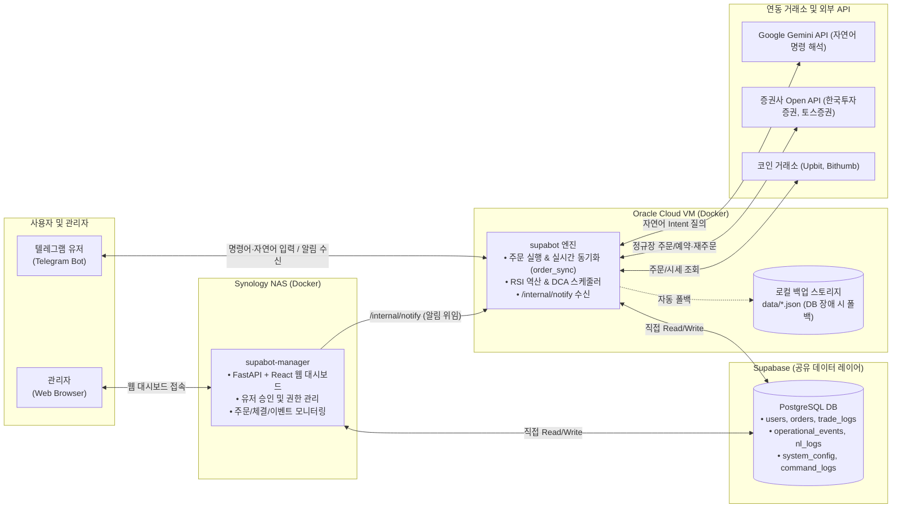

# supabot (Telegram Trading Bot)

Oracle Cloud VM Docker 환경에서 24시간 무중단 구동되는 **멀티유저 & 멀티거래소 통합 자동매매 시스템**입니다. 단순한 주문 도구를 넘어, 실시간 주문 동기화 엔진, RSI 가격 역산 알고리즘, 분할 적립식 매수(DCA), Gemini 자연어 인터페이스 및 웹 모니터링 대시보드를 제공합니다.

---

## 🧭 시스템 구성

봇(트레이딩 엔진)과 관리 대시보드(supabot-manager)는 **Supabase PostgreSQL을 공유 데이터 레이어로** 사용하는 독립 컴포넌트로 분리되어 있습니다.



- **봇 → Supabase 직접 read/write**: DB 장애 시 `data/*.json` 로컬 파일로 자동 폴백
- **manager → Supabase 직접 read/write**: 사용자 관리 및 모니터링, 알림 위임 시에만 봇의 `/internal/notify` 호출
- 모노레포 구조: 봇 엔진(`src/`), 관리 UI(`manager/`), 공유 스키마(`shared/schema.sql`)

---

## 🚀 핵심 기능

- **지능형 RSI 순환 매매 (`/rsitrade`)**: 목표 RSI에 도달하는 가격을 이분 탐색(Binary Search)으로 실시간 역산하여 분할 매집 및 자동 익절
- **거미줄 분할 매매 (`/grid`, `/sgrid`)**: 지정한 가격 범위 내 등간격 호가 매수/매도 주문 배치
- **분할 적립식 매수 (`/dca`)**: 설정한 주기와 금액에 맞춰 자동으로 분할 매수하는 적립식 투자 전략
- **실시간 주문 동기화 (`order_sync`)**: 거래소 앱/웹에서 직접 체결/취소한 내역도 1분 이내 자동 감지 및 상태 갱신
- **장 마감 자동 복구**: KIS/토스 국내주식 장 마감 만료 시 잔량에 대해 다음 영업일 정규장에 동일 조건으로 자동 재주문(`pending_reorder`)
- **Gemini 자연어 인터페이스**: 일상 언어("비트코인 100만원어치 사줘")를 의도로 자동 변환하며, 주문/설정 변경은 2단계 확인 버튼을 통해 안전하게 실행
- **멀티 거래소 통합 지원**: 업비트, 빗썸, 한국투자증권(국내주식), 토스증권(국내/해외주식)
- **강력한 보안**: 사용자 API 키는 마스터키 기반 Fernet 암호화(`enc:v1:`)로 Supabase DB에 보관

---

## ⚡ 빠른 시작 (Quick Start)

### 1. 신규 사용자 등록 및 연동
1. 텔레그램에서 봇에게 `/start` 메시지를 전송합니다 (최초 등록 시 승인 대기 상태).
2. 관리자가 `supabot-manager` 웹 대시보드에서 사용자를 `active`로 승인합니다.
3. 텔레그램에서 `/config` 명령어로 거래소 및 Gemini API 키를 등록합니다.
4. 웹 대시보드가 필요한 경우 관리자가 `manager_email`을 연결하고 Supabase Auth 계정을 발급합니다.

> 📖 상세 온보딩 절차: [101_user_onboarding.md](file:///E:/apps/supabot/docs/101_user_onboarding.md)  
> 🔑 거래소별 API 키 발급 가이드: [103_exchange_api_setup.md](file:///E:/apps/supabot/docs/103_exchange_api_setup.md)

### 2. 서버 실행 최소 환경 변수 (`config/.env`)
```env
TELEGRAM_BOT_TOKEN=여러분의_텔레그램_봇_토큰
ADMIN_CHAT_ID=최고_관리자_숫자_ID
USER_SECRET_KEY=Fernet_마스터키  # python -c "from cryptography.fernet import Fernet; print(Fernet.generate_key().decode())"

# Supabase 공유 데이터 레이어 (필수)
SUPABASE_URL=https://your-project.supabase.co
SUPABASE_SERVICE_KEY=your_service_role_key

# supabot-manager 알림 연동 (선택)
MANAGER_API_KEY=32자_이상의_공유_랜덤키
INTERNAL_PORT=8765
```

### 3. Docker Compose 실행 (Oracle Cloud VM)
```yaml
services:
  supabot:
    image: ghcr.io/antny-bot/supabot:latest
    container_name: supabot
    restart: unless-stopped
    network_mode: host
    environment:
      TZ: Asia/Seoul
    volumes:
      - ./config/.env:/app/config/.env:ro
      - ./data:/app/data
```

> 📖 서버 VM 설정: [401_oracle_cloud_vm_setup.md](file:///E:/apps/supabot/docs/401_oracle_cloud_vm_setup.md)  
> 📖 배포 순서 가이드: [402_oracle_cloud_deploy_sequence.md](file:///E:/apps/supabot/docs/402_oracle_cloud_deploy_sequence.md)  
> 📖 CI/CD 워크플로우 명세: [403_github_actions_workflows.md](file:///E:/apps/supabot/docs/403_github_actions_workflows.md)

---

## 📜 명령어 요약 (Cheat Sheet)

모든 명령어는 `/[명령어] -h`를 통해 실시간 상세 가이드와 예시를 확인할 수 있습니다.

| 구분 | 명령어 | 설명 |
|------|--------|------|
| **기본 & 설정** | `/start` | 시스템 접속 및 메뉴 안내 (승인 대기 등록) |
| | `/status` | 전체 가동 중인 트레이딩 전략 통합 대시보드 브리핑 |
| | `/config` | 거래소별 API 키 및 기본 거래소 설정 (대화형 버튼) |
| | `/config -v` | API 키 유효성, RSI 설정 및 Gemini 자연어 설정 확인 |
| | `/whoami` | 내 계정 권한, 활성 상태, 기본 거래소 확인 (`/me` 지원) |
| | `/help` | 전체 명령어 사용 가이드 출력 |
| **자산 & 시세** | `/asset` | 통합 보유 자산 및 평가금액 현황 조회 |
| | `/price` (`/p`) | 특정 종목 실시간 현재가 및 등락률 확인 |
| | `/indicators` (`/ind`) | RSI, MACD, 볼린저밴드, 스토캐스틱 멀티지표 조회 |
| | `/history` | 최근 체결 완료 거래 내역 (버튼 페이징) |
| | `/report` | 기간별 실현 손익 및 체결 요약 리포트 |
| **매매 & 전략** | `/rsitrade` | 목표 RSI 구간 기반 실시간 가격 역산 분할 매집/익절 전략 |
| | `/grid` / `/sgrid` | 지정 가격 범위 내 거미줄 분할 매수 / 분할 매도 배치 |
| | `/dca` | 주기적 분할 적립식 매수 전략 설정 및 관리 |
| | `/buy` / `/sell` | 단일 지정가 매수/매도 주문 (확인 버튼 후 실행) |
| | `/orders` | 현재 추적 중인 미체결 주문 목록 조회 |
| | `/cancel` | 특정 종목 또는 주문 번호 일괄 취소 |
| **시그널 감시** | `/watch` / `/unwatch` | RSI 과매도 매수 시그널 실시간 모니터링 등록/해제 |
| **관리자 전용** | `/halt` / `/resume` | 전역 거래 킬스위치 즉시 중지 / 재개 |
| | `/dbsync` | Supabase DB 주문 상태를 메모리에 강제 재동기화 |
| | `/resetuser <id>` | 특정 유저의 주문 추적 및 실적 완전 초기화 |
| | `/backup [status\|now]` | Supabase 전체 백업 상태 조회 및 즉시 수동 백업 실행 |

> 📖 핸들러 세부 구조 및 파라미터 명세: [205_main_handlers.md](file:///E:/apps/supabot/docs/205_main_handlers.md)

---

## 📈 트레이딩 전략 & 시장 정책

| 전략/정책 | 핵심 동작 요약 | 상세 문서 |
|-----------|----------------|-----------|
| **RSI 역산 순환 매매** | 지표 지연 없이 목표 RSI가 되는 가격을 이분 탐색으로 역산하여 타점 진입, 체결 수량만큼 목표 RSI 매도 자동 대기, 손절 및 트레일링 스톱 연동 | [301_rsi_algorithm.md](file:///E:/apps/supabot/docs/301_rsi_algorithm.md) |
| **한국투자증권(KIS) 정책** | 평일 09:00~15:35 정규장 운영, 장외 주문은 `reserved` 예약 접수, 장 마감 시 만료 주문은 잔량 계산 후 익일 자동 재주문(`pending_reorder`) | [302_kis_market_policy.md](file:///E:/apps/supabot/docs/302_kis_market_policy.md) |
| **토스증권 국내/해외 정책** | 단일 인터페이스에서 국내주식(005930)과 미국주식(AAPL) 심볼 자동 판별, 센트/호가단위 자동 보정 및 통화 분기 | [303_toss_overseas_stock.md](file:///E:/apps/supabot/docs/303_toss_overseas_stock.md) |
| **Gemini 자연어 처리** | 안전한 단순 조회는 룰 기반 즉시 실행, 주문/설정 변경은 Gemini Intent 해석 후 2단계 확인 버튼을 거쳐 엄격한 서버 검증 후 실행 | [304_gemini_intent.md](file:///E:/apps/supabot/docs/304_gemini_intent.md) |

---

## 🏗 시스템 아키텍처 및 모듈 구성 (최신)

최신 코드베이스는 관심사 분리(SoC) 원칙에 따라 메인 엔진, 기능별 핸들러, 코어 라이브러리로 모듈화되어 있습니다.

```
supabot/
├── src/
│   ├── main.py                    # 텔레그램 봇 진입점, 스케줄러 등록 및 루프 실행
│   ├── internal_api.py            # FastAPI 기반 내부 알림/제어 webhook 서버 (/internal/notify)
│   ├── handlers/                  # 기능별 텔레그램 명령어 핸들러 모듈
│   │   ├── strategy_handlers.py   # /rsitrade, /grid, /sgrid 전략 핸들러
│   │   ├── dca_handlers.py        # /dca 적립식 매수 핸들러
│   │   ├── manual_order_handlers.py# /buy, /sell, /cancel 단일 주문 핸들러
│   │   ├── query_handlers.py      # /asset, /price, /indicators, /help 시세/정보 조회
│   │   ├── list_view_handlers.py  # /orders, /history, /report 목록 및 페이징 핸들러
│   │   ├── status_handlers.py     # /status 전략 대시보드 핸들러
│   │   ├── config_handlers.py     # /config, /whoami 설정 핸들러
│   │   ├── watch_handlers.py      # /watch, /unwatch 시그널 감시 핸들러
│   │   ├── system_handlers.py     # /start, /halt, /resume, /dbsync, /resetuser, /backup 시스템 핸들러
│   │   └── nl_intent_handlers.py  # Gemini 자연어 인텐트 실행 및 콜백 핸들러
│   └── core/                      # 핵심 비즈니스 로직 및 엔진
│       ├── order_sync.py          # 거래소 실시간 주문 동기화 및 만료/체결 처리 엔진
│       ├── order_execution.py     # 주문 생성 및 체결 사후 연동 처리
│       ├── order_manager.py       # 인메모리 주문 상태 관리 (DB 우선 + 파일 폴백)
│       ├── dca_manager.py         # DCA 적립식 매수 스케줄 및 실행 관리
│       ├── signal_engine.py       # RSI 계산 및 목표 가격 역산 엔진
│       ├── exchange_adapter.py    # 거래소 통합 인터페이스 (Upbit, Bithumb, KIS, Toss)
│       ├── exchanges/             # 거래소별 전용 구현체 (base, upbit, bithumb, kis, toss)
│       ├── user_manager.py        # 멀티유저 권한/설정 관리
│       ├── secret_crypto.py       # 사용자 키 Fernet 대칭키 암복호화
│       ├── trading_gate.py        # 킬스위치 및 총 노출 한도 검증 게이트
│       ├── db.py & db_sync.py     # Supabase REST 클라이언트, SQLite 읽기 폴백 및 데이터 동기화
│       ├── backup_manager.py      # Supabase 정기 백업, SQLite/ZIP 스냅샷 및 로컬/Drive 보존 관리
│       ├── gdrive_client.py       # Google Drive REST API v3 업로드 및 OAuth 토큰 갱신
│       ├── budget_ledger.py       # 전략 예산 원장(budget_ledger) 감사 기록 및 정산
│       ├── natural_language.py    # Gemini 자연어 전처리 및 로깅
│       └── nl_agent.py            # Gemini Function Calling 멀티턴 에이전트 루프
├── manager/                       # supabot-manager 웹 대시보드 (FastAPI + React/TS)
├── shared/schema.sql              # Supabase PostgreSQL 공유 스키마 (orders, users, logs 등)
└── docs/                          # 체계적인 개발 문서 및 운영 가이드
```

> 📖 전체 아키텍처 및 DB 스키마 명세: [200_system_architecture.md](file:///E:/apps/supabot/docs/200_system_architecture.md)  
> 📖 관리 대시보드 매뉴얼: [manager/README.md](file:///E:/apps/supabot/manager/README.md)

---

## 🗂 개발 문서 인덱스 (Documentation Hub)

프로젝트의 모든 설계, 알고리즘, 배포 및 운영 문서는 넘버링 체계로 관리됩니다.

### 1. 개요 및 온보딩
- [[100] 프로젝트 표준 및 안전 규칙](file:///E:/apps/supabot/docs/100_project_standards.md) — 실거래 주의사항, 테스트 제약, 키 관리 원칙
- [[101] 유저 온보딩 가이드](file:///E:/apps/supabot/docs/101_user_onboarding.md) — 신규 유저 등록 및 대시보드 연동 흐름
- [[102] 로드맵 V3](file:///E:/apps/supabot/docs/102_roadmap_v3.md) — 기능 개선 계획 및 로드맵
- [[103] 거래소 API 키 발급 가이드](file:///E:/apps/supabot/docs/103_exchange_api_setup.md) — 업비트/빗썸/한투/토스/Gemini 키 발급 및 등록

### 2. 아키텍처 및 모듈 구현
- [[200] 시스템 아키텍처 및 데이터 스키마](file:///E:/apps/supabot/docs/200_system_architecture.md) — 봇/UI 맵, DB 스키마, 연동 제약
- [[201] 거래소 어댑터](file:///E:/apps/supabot/docs/201_exchange_adapter.md) — Upbit, Bithumb, KIS, Toss 통합 추상화
- [[202] 주문 관리자](file:///E:/apps/supabot/docs/202_order_manager.md) — 주문 상태 추적 및 DB 동기화
- [[203] 사용자 관리자](file:///E:/apps/supabot/docs/203_user_manager.md) — 멀티유저 권한, 환경 설정 및 키 관리
- [[204] 시그널 엔진](file:///E:/apps/supabot/docs/204_signal_engine.md) — RSI 계산 및 지표 분석
- [[205] 메인 핸들러](file:///E:/apps/supabot/docs/205_main_handlers.md) — 텔레그램 명령 처리 및 루프 통제
  - [[205a] 자연어 처리 흐름](file:///E:/apps/supabot/docs/205a_natural_language.md) — Gemini 자연어 처리 및 로그 명세
  - [[205b] 보안 및 안전장치](file:///E:/apps/supabot/docs/205b_security_logging.md) — API 암호화, 일회용 토큰, 킬스위치
  - [[205c] 유틸리티 파서](file:///E:/apps/supabot/docs/205c_utility_parsers.md) — 파서 및 포맷터 함수 목록
- [[206] 토스 API 레퍼런스](file:///E:/apps/supabot/docs/206_toss_api_reference.md) — Toss 엔드포인트 및 필드 명세

### 3. 알고리즘 & 거래 정책
- [[301] RSI 거래 알고리즘](file:///E:/apps/supabot/docs/301_rsi_algorithm.md) — RSI 가격 역산 수식 및 거미줄 매매 로직
- [[302] 한국투자증권(KIS) 시장 정책](file:///E:/apps/supabot/docs/302_kis_market_policy.md) — KIS 정규장/장외 매매 정책 및 자동 재주문
- [[303] 토스증권 해외주식 정책](file:///E:/apps/supabot/docs/303_toss_overseas_stock.md) — 해외주식 통화 분기, 틱사이즈 보정
- [[304] Gemini 자연어 인텐트 분석](file:///E:/apps/supabot/docs/304_gemini_intent.md) — LLM 자연어 처리, 인텐트 보정 및 로깅

### 4. 인프라 및 CI/CD 배포
- [[401] Oracle Cloud VM 설정](file:///E:/apps/supabot/docs/401_oracle_cloud_vm_setup.md) — 서버 VM 초기 셋업 및 네트워크 보안
- [[402] Oracle Cloud 배포 순서](file:///E:/apps/supabot/docs/402_oracle_cloud_deploy_sequence.md) — Docker 빌드 및 운영 배포 시퀀스
- [[403] GitHub Actions 워크플로우](file:///E:/apps/supabot/docs/403_github_actions_workflows.md) — GHCR 분기 빌드 및 CI/CD 자동화 사양

---

## ⚠️ 면책 조항 (Disclaimer)

본 소프트웨어는 투자 보조 도구일 뿐이며, 투자에 대한 모든 책임은 사용자 본인에게 있습니다. 매매 수수료, 슬리피지 및 거래소별 호가 단위 보정에 유의하여 사용하시기 바랍니다.
