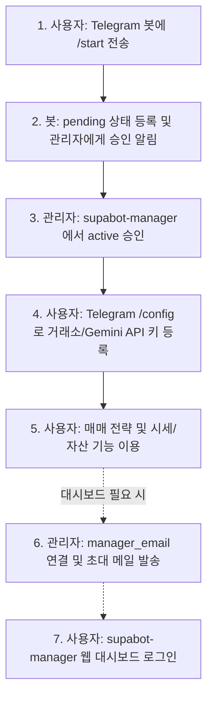

# 101_user_onboarding.md — 사용자 온보딩 가이드

`supabot` 신규 사용자 등록, 거래소 API 키 연동 및 `supabot-manager` 웹 대시보드 연결 절차 가이드입니다.

---

## 한눈에 보는 흐름

---

## 1. 사전 준비

- `supabot` 봇 컨테이너 실행 중 (Oracle Cloud VM)
- `supabot-manager` 웹 대시보드 가동 중 (Synology NAS Docker)
- 봇과 manager가 동일한 Supabase 프로젝트를 참조 중
- 최고 관리자 권한 (`ADMIN_CHAT_ID`) 보유

---

## 2. 텔레그램 봇 사용자 등록 및 승인

### 사용자가 할 일
1. Telegram 앱에서 본인의 봇 계정 검색 후 대화 시작
2. `/start` 입력 전송
3. "관리자 승인 대기 중" 메시지 확인 후 대기

### 관리자가 할 일
1. `supabot-manager` 웹 대시보드 접속 (`/users` 메뉴)
2. `pending` 상태인 신규 사용자 확인
3. `Approve` 버튼 클릭하여 `active` 상태로 승인
4. 승인 즉시 사용자에게 승인 완료 텔레그램 알림이 자동 전송됩니다.

---

## 3. 거래소 및 Gemini API 키 등록

승인된 사용자는 매매 및 시세 조회를 위해 거래소 API 키를 등록합니다. 키는 절대로 `.env`에 넣지 않고 Telegram 대화창에서 안전하게 등록합니다.

- **지원 거래소**: 업비트, 빗썸, 한국투자증권(KIS), 토스증권(Toss)
- **자연어 처리**: Google Gemini API
- **상세 발급 및 등록 절차**: [103_exchange_api_setup.md](file:///E:/apps/supabot/docs/103_exchange_api_setup.md) 참조

등록된 키는 `USER_SECRET_KEY` 마스터키를 통해 Fernet 암호화되어 Supabase DB에 보관됩니다.

---

## 4. 웹 대시보드(supabot-manager) 연동

웹 대시보드 접근이 필요한 사용자에게 대시보드 계정을 부여합니다.

### 4-1. 관리자: 이메일 연결 및 초대
1. `supabot-manager` 사용자 목록에서 대상 사용자 선택
2. `manager_email` 항목에 로그인에 사용할 이메일 입력 후 저장
3. `초대 메일 발송` 버튼 클릭 (Supabase Auth 사용자 자동 생성 및 비밀번호 설정 링크 메일 발송)

> **대안 (수동 생성)**:
> Supabase 대시보드 > `Authentication` > `Users`에서 동일한 이메일로 수동 생성 가능합니다. (반드시 `users.manager_email`과 일치해야 함)

### 4-2. 사용자: 비밀번호 설정 및 로그인
1. 수신된 초대 메일의 링크를 통해 비밀번호 설정
2. `supabot-manager` 웹 대시보드 URL에 접속하여 이메일/비밀번호로 로그인
3. 필요 시 2단계 인증(MFA OTP) 활성화

---

## 5. 자주 발생하는 문제 및 해결

- **`/start` 전송 후 계속 대기 상태인 경우**: 관리자가 대시보드에서 `Approve`를 눌렀는지 확인하세요.
- **manager 로그인 실패**: Supabase Auth 계정의 이메일과 `users.manager_email`이 완전히 일치하는지 확인하세요.
- **MFA 분실로 로그인 불가 시**: 대시보드 관리자 계정 또는 Supabase 대시보드에서 해당 사용자의 MFA 설정을 초기화할 수 있습니다.

---

## 6. 관련 개발 문서

- **전체 시스템 개요**: [README.md](file:///E:/apps/supabot/README.md)
- **거래소 API 키 발급 가이드**: [103_exchange_api_setup.md](file:///E:/apps/supabot/docs/103_exchange_api_setup.md)
- **사용자 관리자 모듈**: [203_user_manager.md](file:///E:/apps/supabot/docs/203_user_manager.md)
- **웹 대시보드 매뉴얼**: [manager/README.md](file:///E:/apps/supabot/manager/README.md)
