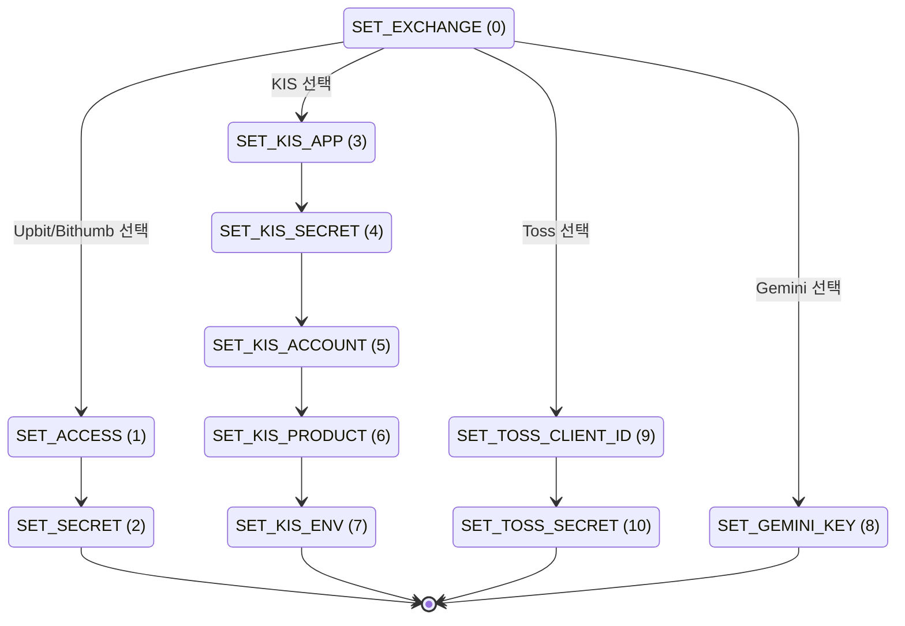

# 205_main_handlers.md

**파일**: `src/main.py` (메인 봇 제어 흐름, 핸들러 분리 구조)

## 모듈 전역 객체

```python
user_manager     = UserManager()
exchange_adapter = ExchangeAdapter(user_manager)
order_manager    = OrderManager()
dca_manager      = DcaManager()
signal_engine    = SignalEngine(user_manager, exchange_adapter)
metrics          # core.metrics — 인메모리 운영 지표 (주문 성공률, 레이턴시, 루프 타임스탬프)
_order_wake_event: asyncio.Event    # 새 주문 발생 시 sync 루프 즉시 기상
_pending_nl_intents: dict           # token → {user_id, intent} (Gemini 확인 대기)
KST = timezone(timedelta(hours=9))
```

- **데이터 영속화**: `core.db` (Supabase REST 클라이언트) 우선 사용 + `data/*.json` 로컬 파일 폴백.
- `user_manager`/`order_manager`는 DB 우선, `trade_log`/`operational_events`는 DB+파일 이중 쓰기.

## 커맨드 맵

| 커맨드 | 핸들러 | 비고 |
| :--- | :--- | :--- |
| `/start` | `start_command` | 유저 등록, 관리자 승인 요청 |
| `/help`, `/commands` | `help_command` | 전체 커맨드 메뉴 출력 |
| `/info` | `info_command` | `build_info.py` 버전/빌드 정보 조회 |
| `/config`, `/cfg` | `config_command` | 다단계 키 설정 (ConversationHandler) |
| `/whoami`, `/me` | `whoami_command` | ID, 권한, 활성 상태 확인 |
| `/asset` | `asset_command` | 전체 잔고 조회. 상위 5개 표시, 인라인 접기/펼치기 지원 |
| `/price`, `/p` | `price_command` | 실시간 시세 조회 |
| `/indicators`, `/ind` | `indicators_command` | RSI/MACD/볼린저밴드/스토캐스틱 통합 조회 |
| `/history` | `history_command` | 최근 체결 내역 (5건씩 페이지네이션) |
| `/report` | `report_command` | 기간별 수익률 리포트 (10건씩 페이지네이션) |
| `/orders` | `orders_command` | 추적 중인 미체결 주문 목록 (배치 번호별 요약/펼치기) |
| `/status` | `status_command` | 전략 대시보드 (그룹당 3건 요약/펼치기) |
| `/buy` | `buy_command` | 지정가 매수 (서버 토큰 10분 만료 검증) |
| `/sell` | `sell_command` | 지정가 매도 (서버 토큰 10분 만료 검증) |
| `/grid` | `grid_command` | 지정 범위 분할 매수 전략 실행 |
| `/sgrid` | `sgrid_command` | 보유 수량 분할 매도 전략 실행 |
| `/rsitrade`, `/gridrsi`| `rsitrade_command` | RSI 역산 분할 매수 전략 (linked_to 자동 익절 매도 생성) |
| `/sgridrsi` | `sgridrsi_command` | RSI 목표가 분할 매도 전략 |
| `/dca` | `dca_command` | 정기 분할/적립식 매수 스케줄 등록 및 실행 |
| `/sdca` | `sdca_command` | 정기 분할 매도 스케줄 등록 및 실행 |
| `/cancel` | `cancel_command` | 종목 전체 주문 취소 |
| `/cancelno` | `cancelno_command` | 배치 번호(#N) 기준 주문 묶음 취소 |
| `/watch` | `watch_command` | RSI 감시 대상 종목 추가 |
| `/unwatch` | `unwatch_command` | RSI 감시 대상 종목 제거 |
| `(일반 텍스트)` | `natural_language_command` | Gemini 자연어 분석 처리 |

*(※ `/me`, `/p`, `/ind`, `/cfg`, `/rsigrid` 등 단축/비밀 alias는 텔레그램 공식 메뉴에 미노출, CommandHandler로 작동)*

## ConversationHandler 상태 (/config)


- API 키 포함 사용자 입력 메시지는 캡처 즉시 삭제 처리 (`delete_message`).

## 인증 미들웨어

- `@check_auth` 데코레이터 적용:
  1. `user_manager.get_user(chat_id)` 조회.
  2. 미등록 유저 시 안내 메시지 반환 후 중단.
  3. `is_active=False` (승인 대기) 상태 시 승인 대기 메시지 반환 후 중단.
  4. 정상 유저인 경우 핸들러 호출 (`user` 딕셔너리를 세 번째 인자로 전달).

## 백그라운드 루프

### order_sync_loop
- 주기적 주문 및 스케줄 통합 실행 루프:
  1. `order_manager` / `dca_manager` / `user_manager` DB 비동기 리로드.
  2. `execute_due_dca_schedules(...)`: 실행 시각 도래한 정기 매수/매도(DCA/SDCA) 스케줄 주문 제출:
     - **주문 방식**: 지정가(`limit`, 호가 버퍼 반영) 및 시장가(`market`, 즉시 체결, 코인 거래소는 총액 매수) 지원. 시장가 매수 체결 완료 시 실제 체결 수량으로 `orders`의 `volume`을 자동 보정하며, 실제 소요 금액과 당초 주문 추정액의 차액을 `budget_ledger`(`BUY_ORDER_ADJUST`)에 정산(지정가 주문은 수량 보정 제외).
     - **예산 한도 및 원장 연동**: 템플릿 연동 KRW 매수 시 주문 접수 직후 `budget_ledger`(`BUY_ORDER_SPEND`)에 불변 감사 원장을 기록하고 최신 `params`의 잔액만 원자적으로 차감. volume형 매수는 시장가/지정가 기준 평가 가격(`eval_price`)으로 1주 가격 및 최대 매수 수량을 사전 검사하여 잔액 초과 방지. DB 쿼리 실패 시 5분 안전 보류.
     - **이월 정책 및 상태 관리**: 거래소 휴장 또는 사이드카/서킷브레이커 감지 시 이월 모드(`next_day`, `delay_20m`, `skip`) 적용. 사이드카 지속 시 최대 12회(4시간) 상한 초과 후 일반 실패로 전환하며, 휴장 이월(`delay_20m`/`next_day`) 및 성공·일반 실패 시 `carryover_count`는 `_clear_carryover`/`_set_carryover` 헬퍼를 통해 스케줄과 원본 양쪽에서 즉시 초기화. 알림은 최초 1회만 발송하며 실제 재시도 시점에 맞게 문구 분기(+20분 이월 vs 다음 개장 이월).
     - **안전 게이트**: 비활성 유저 최우선 검사 및 글로벌 킬스위치 활성화 시 알림 없는 5분 무음 지연.
  3. `sync_orders(application)` (`src/core/order_sync.py`): 주문 상태 폴링, 부분/전체 체결 감지, 연동 익절 매도 생성, KIS 장외 재주문 등 처리.
  4. `check_daily_cash_alerts(...)`: DCA 당일 매수 예수금 부족 사전 감지 및 알림.
- 간격: 주문 존재 시 `poll_active_interval` (60초) / 주문 미존재 시 `poll_no_order_interval` (300초) 기준, 가장 가까운 DCA 실행 예정 시각(`nearest_next_run_delay()`)과 비교하여 최소값으로 동적 슬립.
- `_order_wake_event` 발생 시 대기 루프 즉시 기상.
- 백그라운드 태스크: `_spawn_bg(coro)`를 통해 Strong Reference를 유지하여 GC 조기 수거 방지.
- 성공 시 `metrics.record_poll_ok()` 타임스탬프 기록.

### signal_analysis_loop
- `signal_engine.analyze_watchlist(application)` 주기적 실행.
- 간격: `signal_analysis_interval` (300초). `system_config` 테이블 값 우선 사용.

### sync_orders 핵심 처리 흐름 (`src/core/order_sync.py`)
1. **취소 요청 주문 우선 처리 (`status == "cancel_requested"`, `_handle_cancel_requested`)**:
   - **미제출 가상 주문 (`reserved:`)**: 거래소에 주문이 나가지 않은 상태이므로 `order_manager.remove_order(uuid)`로 즉시 메모리/DB에서 삭제.
   - **거래소 제출 주문 선조회**: 실거래소 취소 호출 전 `exchange_adapter.get_order_status`를 호출하여 현재 체결 상태를 조회.
     - **이미 전량 체결 (`state == "done"`)**: `_process_order_fill`로 전환하여 즉시 정상 체결 처리(체결 알림, trade_logs 기록, linked_to 매도 생성 등).
     - **부분 체결 감지 (`executed_volume > 0`)**: 실거래소 취소 성공(`cancel_and_remove_order`) 후 `append_trade`를 호출하여 부분 체결된 수량과 수수료(`fee_amount`), `group_no`, `template_id`를 `trade_logs`에 기록. 이를 통해 매니저 백엔드의 예산 대사(Reconciliation) 시 체결분이 정확히 인식되도록 보장.
     - **거래소 취소 실패 시**: 주문을 삭제하지 않고 `cancel_requested` 상태를 그대로 유지하여 다음 sync 주기에서 재시도.
2. **장외 예약 주문 정규장 제출 (`status == "reserved"`)**:
   - `supports_reserved_orders=True` 거래소(KIS/Toss) 주문이 정규장에 도달하면 실제 거래소에 주문 제출 후 `replace_order_uuid(old_uuid, new_uuid)`로 실 UUID 교체.
3. **KIS 장외 세션 판정**:
   - `market_closed` / `pending_reorder` 판정 시 `next_check_at` 대기 시각 설정.
4. **KIS 재주문 (`pending_reorder`)**:
   - `pending_reorder` 상태 잔량에 대해 정규장에 재주문 시도 (`replace_order_uuid`).
5. **일반 주문 체결 조회**:
   - `get_order_status` 실시간 조회, 부분 체결 발생 시 `filled_volume` 갱신.
6. **연동 주문 익절 매도**:
   - rsitrade/gridrsi 매수 체결 완료 및 `linked_to` 존재 시 목표 익절가 계산 후 즉시 매도 주문 전송 (`rsitrade_sell`).
   - 이때 매수 주문의 `template_id`를 그대로 승계하여 등록함으로써 체결 및 매도 대금의 예산 원장(Ledger) 환원·재투자 감사 추적성을 일관되게 보장.
7. **종료 판정**:
   - `done`/`cancel` 도달 시 추적 리스트에서 제외 (KIS 전략 등은 제외).

## KIS 시간 헬퍼
- `is_kis_regular_session(now=None)` -> bool (평일 09:00–15:35 KST 판정).
- `next_kis_regular_session(now=None)` -> datetime (다음 정규장 시작일시).
- `kis_next_check_timestamp(now=None)` -> float (다음 체크 Unix timestamp).

---

## 🔗 연관 명세 문서
- **주문 관리자 및 상태 기계**: [202_order_manager.md](file:///E:/apps/supabot/docs/202_order_manager.md)
- **자연어 처리 및 인텐트 흐름**: [205a_natural_language.md](file:///E:/apps/supabot/docs/205a_natural_language.md)
- **보안 설정 및 일회용 토큰, 안전장치**: [205b_security_logging.md](file:///E:/apps/supabot/docs/205b_security_logging.md)
- **유틸리티 파서 및 포맷터 함수**: [205c_utility_parsers.md](file:///E:/apps/supabot/docs/205c_utility_parsers.md)
