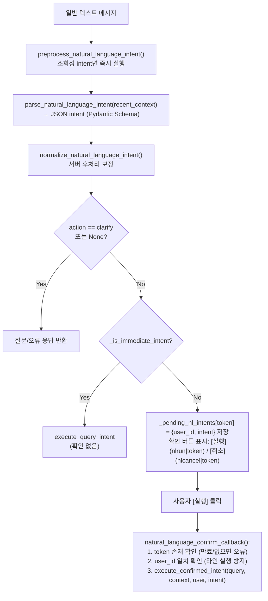

# gemini_intent.md — Gemini 자연어 Intent 처리

## 개요

`llm_enabled=True` 시 텍스트 메시지 룰 기반 전처리. 미처리 문장만 Google Gemini API로 JSON intent 변환. "비트코인 시세 알려줘" 등 자연어 입력 가능.
Gemini 호출 시 **Pydantic Structured Outputs (`TradeIntentModel`)** 및 **최근 대화 맥락(Recent Context)**을 지원합니다.

## 사전 조건

- `users.json → llm.gemini_api_key` 설정 필요
- `llm_enabled=True` 필요
- `validate_config_update`: `llm_enabled=True` + 빈 API 키 조합 → `ValueError`

## 룰 기반 전처리

Gemini 호출 전 `preprocess_natural_language_intent(text, user)` 실행.

조회성 action만 허용.

| action | 예시 표현 | 처리 |
|--------|-----------|------|
| `status` | `주문대기중인것은?`, `예약 주문 보여줘`, `전략 상태 알려줘` | 전략 대시보드 즉시 조회 |
| `orders` | `미체결 주문 뭐 있어?`, `오픈오더`, `거래소에 걸린 주문` | 미체결 주문 즉시 조회 |
| `asset` | `잔고 보여줘`, `보유 자산`, `빗썸 잔고` | 자산 조회 |
| `price` | `BTC 시세`, `비트 얼마야`, `삼성전자 가격` | 종목 추출 시 시세 조회 |
| `history` | `최근 체결`, `거래 내역`, `BTC 거래내역` | 최근 체결 조회 |
| `config_view` | `현재 설정 보여줘`, `API 등록 상태` | 설정 조회 |
| `help` | `사용법`, `명령어 알려줘`, `도움말` | 도움말 조회 |
| `rsi` | `BTC RSI 알려줘` | 단일 종목 RSI 조회 |
| `indicators` | `BTC 지표 보여줘` | 다중 보조지표 조회 |

`취소`, `중지`, `매수`, `매도`, `사줘`, `설정해`, `변경`, `켜줘`, `꺼줘` 등 변경성 표현은 전처리 제외. Gemini 및 확인 버튼 흐름으로 전달.

`normalize_natural_language_intent()`로 Gemini intent 후처리. RSI+분할+매도 힌트(`매도`, `팔아`, `팔다` 등) 감지 시 action `sgridrsi`, RSI 구간 `sell_rsi_range` 지정. 매도 힌트 없는 RSI+분할은 `rsitrade` + `buy_rsi_range` 처리.

문장 내 `dca`, `디씨에이`, `물타기` 포함(또는 Gemini `dca_mode: true` 반환) 시 `rsitrade` intent `dca_mode` = `true`. `sgridrsi`(매도) 미적용.

전처리 완료 문장은 Gemini 미호출 및 노로그.
action hit 카운터만 `data/nl_preprocess_hits.json` 저장 (원문/종목/거래소 미저장).
`비트 봐줘` 등 종목은 있으나 의도 불명확 시 시세/자산/전략상태 되물음.

## Gemini 프롬프트 및 Structured Outputs

`_build_llm_prompt(user_text, user, recent_context=None)`:

```
Parse Korean trading bot text. Return JSON matching the schema.
Never execute. Use null for unknown fields.
Use help only for usage/capability questions.
Missing required fields => clarify.
Orders/cancel/config/watch need user confirm.
Pending/reserved/tracked strategy orders => status. Real open/unfilled exchange orders => orders.
매도/팔아 + RSI + 분할 => sgridrsi (sell_rsi_range only, buy_rsi_range=null).
매수/사줘 + RSI + 분할, or RSI + 분할 (no direction) => rsitrade (buy_rsi_range).
grid/gridrsi is price-range; RSI range goes to gridrsi/sgridrsi not grid.
Missing sell_rsi_range for rsitrade/gridrsi => null; server uses default.
dca_mode=true only if user explicitly mentions DCA/물타기/가중치 분할 (rsitrade only); else null.
Exchange: upbit|bithumb|kis|toss|null. Korean stock => kis or toss (default kis if unspecified, toss if user explicitly says 토스/tossinvest). Samsung => 005930. Crypto ticker: BTC/ETH/XRP.
Default exchange: {user's default_exchange}.
Recent conversation context:
{User & Bot recent turns}
Commands:
{LLM_COMMAND_CATALOG}
User text: {text}
```

- Google GenAI SDK 호출 시 `types.GenerateContentConfig(response_mime_type="application/json", response_schema=TradeIntentModel, temperature=0.1)` 적용.
- 프롬프트 문자열 조작 대신 Pydantic 모델을 스키마로 직접 전달하여 타입 안정성 보장.

## Multi-turn 최근 대화 맥락 (Recent Context)

사용자가 연속 대화 시 이전 발화의 종목이나 의도를 승계할 수 있도록 슬라이딩 윈도우 컨텍스트를 지원합니다.
- 보관 위치: `context.user_data["_nl_recent_context"]`
- 보관 용량: 최근 2턴 (유저 발화 + 봇 의도 최대 4개 아이템)
- 동작 예시:
  1. 유저: *"삼성전자 시세 얼마야?"* → 봇: (price / 005930 해석 및 시세 전송)
  2. 유저: *"그럼 10주 사줘"* → Gemini가 Recent Context를 참조하여 티커 `005930`를 자동으로 보완해 매수 주문 확인창 제시

## Intent 스키마 (`core.nl_schema.TradeIntentModel`)

```python
class TradeIntentModel(BaseModel):
    action: Optional[Literal[
        "asset", "price", "orders", "status", "config_view", "config_set",
        "history", "buy", "sell", "grid", "sgrid", "rsitrade", "gridrsi",
        "sgridrsi", "watch", "unwatch", "cancel", "help", "rsi", "indicators", "clarify"
    ]] = None
    exchange: Optional[Literal["upbit", "bithumb", "kis", "toss"]] = None
    ticker: Optional[str] = None         # "BTC", "005930" 등
    price: Optional[float] = None
    volume: Optional[float] = None
    amount_krw: Optional[int] = None
    start_price: Optional[float] = None
    end_price: Optional[float] = None
    count: Optional[int] = None
    buy_rsi_range: Optional[str] = None  # "25-30" — rsitrade/gridrsi 매수 RSI 구간
    sell_rsi_range: Optional[str] = None # "65-75" — sgridrsi 매도 RSI 구간
    dca_mode: Optional[bool] = None      # true면 rsitrade 예산을 get_dca_weights로 가중 분배
    config_key: Optional[str] = None
    config_value: Optional[str] = None
    question: Optional[str] = None       # action=="clarify" 시 되묻기 질문
```

## 읽기 vs 쓰기 구분

`_is_immediate_intent(action)`으로 즉시 실행 판별:

```python
IMMEDIATE = {"asset", "price", "orders", "status", "config_view", "history", "help", "rsi", "indicators"}
```

| 구분 | 액션 목록 | 처리 |
|------|-----------|------|
| **읽기 (즉시)** | asset, price, orders, status, config_view, history, help, rsi, indicators | `execute_query_intent` |
| **쓰기 (확인)** | buy, sell, grid, sgrid, rsitrade, gridrsi, sgridrsi, watch, unwatch, config_set, cancel | 확인 버튼 표시 후 실행 |

## 확인 플로우



## 미처리 자연어 로그

Gemini 호출 문장은 `append_natural_language_log()`로 `data/nl_unmatched.jsonl` 및 Supabase `nl_logs` 테이블 기록.

기록 항목:

```json
{"ts":"2026-05-30T16:20:00+09:00","text_norm":"BTC <NUMBER>원 주문?","llm_action":"clarify","final_action":"clarify"}
```

로그 미저장 정보:
- chat_id / user_id
- 주문 ID, 거래소 응답 원문
- API 키 또는 긴 토큰 원문

마스킹 규칙:
- 긴 영숫자 토큰 → `<TOKEN>`
- 6자리 숫자 → `<STOCK>`
- 일반 숫자/소수 → `<NUMBER>`

`data/nl_unmatched.jsonl` 최근 500줄 유지.

## 오류 처리

| 상황 | 응답 |
|------|------|
| Gemini API 실패 | None 반환 → "해석할 수 없습니다" 안내 |
| token 만료 (봇 재시작 등) | "만료된 자연어 요청" |
| 다른 유저 확인 클릭 | "다른 사용자의 요청은 실행할 수 없습니다" |
| `execute_confirmed_intent` 예외 | 에러 메시지 유저 전달 |
