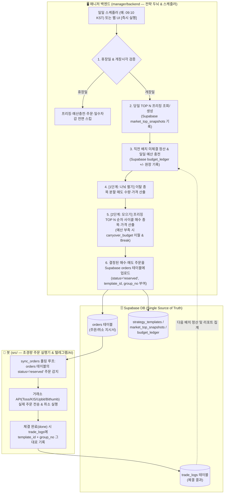

# KOSPI / KOSDAQ 시총 상위 TOP N 모으기 및 분할 매도 전략 템플릿 개발 계획

## 1. 개요 및 핵심 아키텍처 원칙 (Bot 경량화 & Backend+Supabase 주도)

본 계획서는 **봇(`src/`)을 최대한 가볍게 유지(주문 실행기 + 텔레그램/자연어 AI 전담)**하고, **복잡한 전략 계산·스케줄링·예산 원장 관리·TOP N 프리징은 모두 매니저 백엔드(`manager/backend/`)와 Supabase가 담당**하는 아키텍처를 기반으로 설계되었습니다.

### 🏗️ 역할 분담 (Separation of Concerns)

| 계층 | 담당 역할 | 포함하지 않는 것 (분리 원칙) |
|---|---|---|
| **1. 매니저 백엔드 (`manager/backend/`)**<br>*(전략 두뇌 & 스케줄러)* | • KOSPI / KOSDAQ 시총 상위 TOP N 조회 및 `market_top_snapshots` 일별 프리징<br>• `Budget Plan` 버전 관리, 동적 일일 충전액 계산, `budget_ledger`(`+/-` 감사 원장) 기록 및 초기화(Reset)<br>• TOP N 순차 사이클 회전(`current_cycle_bought`) 및 이탈 종목 N일 분할 매도 수량·가격 계산<br>• **결정된 매수/매도 주문을 Supabase `orders` 테이블에 업로드(`status='reserved'`) 및 취소 지시** | 직접 텔레그램 폴링이나 복잡한 거래소 체결 감시 루프를 돌리지 않음 |
| **2. Supabase DB (`shared/schema.sql`)**<br>*(단일 진실 공급원 — Single Source of Truth)* | • 백엔드가 생성한 주문 지시서(`orders`), 체결 결과(`trade_logs`), 전략 상태(`strategy_templates`), 일별 TOP N 프리징(`market_top_snapshots`), 예산 감사 원장(`budget_ledger`) 보관 | — |
| **3. 봇 (`src/`)**<br>*(초경량 주문 실행기 & 텔레그램/AI)* | • **Supabase `orders` 테이블 기준으로 주문 실행 및 취소**: 백엔드가 Supabase에 올린 주문(`reserved`)을 거래소 API(`create_order`)로 실제 전송하고, 체결 상태를 감시해 `orders` 및 `trade_logs`(`template_id`, `group_no` 포함)에 반영<br>• **텔레그램 명령어 및 Gemini 자연어 AI 인텐트 처리**, `/internal/notify` 알림 발송 | ❌ TOP 10 순위 크롤링 없음<br>❌ 월 예산/이월금/사이클 계산 로직 없음<br>❌ 분할 매도 일수/수량 계산 로직 없음 |

---

## 2. 핵심 요구사항 및 정책

### 2.1 대상 거래소(주식·가상자산), 시장 구분, **가변 TOP N(`TOP 5 / 10 / 20`)** 및 **일별 프리징 정책**
- **지원 거래소 (4대 거래소 공통 프레임워크)**:
  - **국내 주식**: **토스증권 (`toss`)**, **한국투자증권 (`kis`)** — `KOSPI` / `KOSDAQ` 시총 상위 TOP N
  - **가상화폐 (확장 호환)**: **업비트 (`upbit`)**, **빗썸 (`bithumb`)** — 원화(KRW) 마켓 상위 TOP N 및 기존 전략(`grid`, `sgrid`, `rsitrade`) 모두 거래소별 예산 Health Check 및 `Active ↔ Holding` 제어 동일 적용
- **대상 시장 및 순위 구간(`rank_start ~ rank_end`) 자유 설정 (`TOP 1~10`, `TOP 5~10`, `TOP 11~20` 등)**:
  - 시장 선택: **`KOSPI` (코스피)**, **`KOSDAQ` (코스닥)** (가상화폐 거래소 선택 시 **`KRW_MAJOR` 원화마켓 상위**)
  - **순위 구간(`rank_start` ~ `rank_end`) 및 1단위 개별 지정 지원 (`1위 ~ 50위`)**:
    - 단순히 `1위~N위`만 고르는 것이 아니라 **시작 순위(`rank_start`, 기본 `1`)와 끝 순위(`rank_end`, 기본 `10`)**를 자유롭게 설정할 수 있습니다.
    - 예:
      - `1위 ~ 5위` (`TOP 1~5`), `1위 ~ 10위` (`TOP 1~10`), `1위 ~ 20위` (`TOP 1~20`)
      - **`5위 ~ 10위` (`TOP 5~10`)** 또는 **`6위 ~ 10위` (`TOP 6~10`)**, **`11위 ~ 20위` (`TOP 11~20`)** 등 특정 순위 밴드(구간)만 타겟팅 가능!
      - 물론 `1위 ~ 7위`, `1위 ~ 8위`처럼 5~10 사이의 임의 개수도 1단위로 자유롭게 설정 가능합니다.
    - 티커 표기도 선택 구간에 따라 `KOSPI_TOP10` (`1~10위`), `KOSPI_TOP5_10` (`5~10위`) 등으로 자동 생성됩니다.
    - **구간 이탈(`rank_start ~ rank_end` 밖으로 벗어남) 시 분할 매도 옵션 (`upper_exit_mode`)**:
      - **하락 이탈 (`rank > rank_end`, 예: 10위 밖으로 밀려남)**: 무조건 N일 분할 매도 수행
      - **상승 이탈 (`rank < rank_start`, 예: `5~10위` 전략인데 `4위`로 승격됨)**:
        - 옵션 1 (`"sell_on_any_exit"` — 기본값): 지정 구간(`5~10위`)을 벗어났으므로 동일하게 N일 분할 매도(수익 실현)
        - 옵션 2 (`"hold_on_promotion"`): 상위 순위(`1~4위`)로 승격된 경우에는 팔지 않고 보유 유지(추가 매수만 중지), `10위` 밖으로 밀려날 때만 분할 매도
- **보통주 필터링 (주식)**: 우선주(종목코드 끝자리가 `0`이 아니거나 종목명이 `우`/`우B` 등으로 끝나는 종목), ETF/ETN/스팩/리츠는 TOP N 산정에서 제외
- **📌 일별 TOP 50 마스터 프리징 & 템플릿별 구간 슬라이싱(`items[rank_start-1 : rank_end]`) 원칙**:
  - **문제점**: 장중에는 주가 등락에 따라 경계선 종목의 시가총액 순위가 분 단위로 뒤바뀔 수 있으며, 사용자마다 `1~5위`, `5~10위`, `1~20위` 등 서로 다른 순위 구간을 설정할 수 있습니다.
  - **해결 (하루 1회 상위 50위 마스터 프리징 후 `items[rank_start-1 : rank_end]` 슬라이싱)**:
    1. **프리징 시점**: 매 영업일 정규장 개장 직후 **첫 스케줄 실행 시점(기본 `09:10 KST`, 개장 지연일엔 `개장시각 + 10분`)**에 시장별(`KOSPI`/`KOSDAQ`) 상위 **50개 보통주**를 한 번에 조회하여 `market_top_snapshots` 테이블에 프리징 저장합니다.
    2. **순위 구간 즉시 대응**: 각 전략 템플릿은 프리징된 상위 50위 마스터 리스트에서 자신의 구간 `items[rank_start - 1 : rank_end]`(예: `5~10위`면 `items[4:10]`)만 잘라서(Slice) 사용하므로, 한 계좌에서 `TOP 1~4` 전략과 `TOP 5~10` 전략을 동시에 돌려도 당일 아침 프리징된 동일 기준 데이터로 오차 없이 동작합니다.
    3. **진입·이탈 비교 기준**: `오늘 프리징된 [rank_start ~ rank_end] 구간 종목`과 `직전 영업일 프리징된 [rank_start ~ rank_end] 구간 종목`을 비교하여 신규 진입(`entered`)과 이탈(`exited`)을 판정합니다.

### 2.2 시장/계좌/실행 10대 예외 시나리오별 상세 대책 및 복구 로직

실거래 운영 중 발생할 수 있는 시장 이상 상황, 계좌 현금 부족, 기업 이벤트, 부분 체결/미체결, 시스템 재시작 등 **10가지 예외 시나리오**에 대해 아래와 같이 상태 머신과 복구 로직을 적용합니다.

| # | 예외 시나리오 | 발생 시 문제점 (구멍) | 상세 대책 및 방어 로직 (코드 반영 사양) |
|---|---|---|---|
| **1** | **임시휴장일 / 공휴일 + 캘린더 API 장애**<br>(선거일, 대체공휴일, 연말 휴장일 등) | • `TossExchange.is_market_open()` 기존 코드에서 `windows == []`(휴장일)일 때 평일 휴리스틱으로 폴백해 개장일로 오판<br>• 만약 선거일에 캘린더 API까지 일시 타임아웃 나면 휴장일에 주문 시도 | • **버그 수정**: `windows is None`(캐시 미로드)일 때만 폴백하고 `windows == []`(명시적 휴장)이면 즉시 `False` 반환<br>• **2중 휴장 검증**: 캘린더 API 응답 실패 시 대표 종목(`005930`)의 당일 일봉 캔들 날짜(`today`) 및 거래량(`volume > 0`)을 교차 확인해 당일 장이 실제로 열렸는지 검증<br>• 휴장일에는 **프리징·일일 예산 충전·매수·매도·분할매도 일수 차감을 모두 스킵** |
| **2** | **개장 시각 변경일**<br>(수능일 10:00 개장, 초일 개장 지연 등) | 고정 `09:10`에 실행 시 장 개장 전이라 당일 기준가/상하한가 미확정 및 호가 왜곡 발생 | • `market-calendar/KR`의 `regularMarket.startTime`을 읽어 **`max(설정 실행시각, 개장시각 + 10분)`** 이후에만 당일 TOP N 프리징 및 배치 실행 |
| **3** | **서킷브레이커 (CB 1·2단계, 20분 중단) & 배치 도중 중단 (Partial Batch)** | 매수 3건 실행 후 4번째 주문 시점에 CB가 발동해 배치가 중단되면, 재시도 시 일일 예산이 2번 충전되거나 이미 판 종목을 또 파는 사고 발생 | • **당일 배치 체크포인트(`daily_batch_state`)**: `"not_started"` → `"in_progress"` → `"delayed_retry"` → `"completed"` 관리<br>• **일일 예산 중복 충전 방지**: `allowance_credited_date == today` 기록으로 하루 1회만 충전 보장<br>• **멱등 재개(Idempotent Resume)**: CB 감지 시 `retry_after_ts = now + 25분` 설정 후 중단. 25분 뒤 재개 시 **동일 `group_no`를 유지**한 채 오늘 아직 처리 안 된 종목만 이어서 실행 |
| **4** | **서킷브레이커 3단계 (당일 장 조기 폐장)** | 장이 그대로 종료되어 남은 주문 발행 자체가 불가능 | • 미집행 가용 예산을 `carryover_budget`에 100% 보존하고, 아직 매도하지 못한 이탈 종목의 `remaining_days`는 차감하지 않고 동결한 뒤 당일 배치를 `"closed_by_cb3"`로 안전 종료 |
| **5** | **사이클 매수 차례인 종목이 '장기 거래정지 / 상한가 / 매수제한'인 경우** | '현재 차례 종목을 살 때까지 뒤 순위를 안 산다(Head-of-Line)' 원칙만 적용하면, 2위 종목이 한 달간 거래정지일 때 **나머지 9개 종목 매수까지 한 달 내내 멈추는 데드락(Deadlock)** 발생 | • **'예산 부족 대기'와 '거래 불가 패스'를 엄격히 분리**:<br>  - `가용 예산 < 1주 가격`: 정상 종목이므로 돈을 모으기 위해 루프 중단(Break) 후 예산 이월<br>  - `가용 예산 ≥ 1주 가격`인데 **거래정지(거래량 0)·상한가 도달·거래소 매수거부**인 경우: 데드락 방지를 위해 해당 종목을 이번 사이클에서 `skipped_untradable`로 패스하고 **즉시 다음 순위 종목 매수로 진행** |
| **6** | **TOP 10 이탈(매도 대상) 종목이 거래정지 또는 하한가인 경우** | 매도 주문이 거부되거나 하한가 적체로 체결이 안 되는데 `remaining_days`만 매일 줄어들면 거래 재개일에 전량 덤핑 또는 매도 누락 발생 | • 이탈 종목이 거래정지이거나 하한가에 도달한 날은 매도 발주를 보류하고 **`remaining_days`를 차감하지 않고 동결(Freeze)**하여 거래 정상화 시점부터 남은 분할 일수대로 매도 |
| **7** | **장부상 전략 가용예산은 충분한데, 실제 토스 계좌 예수금(`cash`)이 부족한 경우** | 사용자가 계좌에 현금을 덜 입금했거나 수동 매수로 현금을 써버려 매수 주문이 `잔고 부족` 실패 | • **매도 선행 (Sell-Before-Buy)**: 배치 실행 시 **[1단계: 이탈 종목 분할 매도]를 먼저 실행 → [2단계: TOP 10 매수]** 순으로 실행해 매도 대금을 확보<br>• **실계좌 예수금 가드**: 토스 `/api/v1/buying-power`의 실제 `cash`가 타겟 1주 가격보다 적으면, **전략 장부상 `carryover_budget`은 깎지 않고 보존**한 채 매수만 일시 보류하고 `"⚠️ 계좌 실제 예수금 부족"` 알림 전송 |
| **8** | **지정가 매수·분할매도 주문의 장마감 미체결 취소(`cancel`) 및 부분 체결(`partial`)** | • 매수 주문이 장마감 미체결 취소됐는데 사이클 완료로 남으면 해당 종목 누락<br>• 분할매도 주문이 미체결 취소됐는데 일수만 차감되면 분할 비율 왜곡 | • **직전 배치 주문 정산(Reconciliation) 단계**: 매일 새 배치 시작 전 `pending_buy_orders` / `pending_sell_orders`의 최종 체결량을 확인<br>  - 미체결 취소된 매수분: `미체결수량 × 주문단가`를 `carryover_budget`으로 환원(`monthly_spent` 차감) 및 `current_cycle_bought`에서 제거하여 재매수<br>  - 전량 미체결 취소된 분할매도분: 차감했던 `remaining_days`를 `+1` 복원<br>• **체결 우선 호가 옵션(`order_price_mode`)**: `limit_current`(현재가 지정가), `limit_aggressive`(매수 +2틱 / 매도 -2틱 지정가), `market`(시장가) 선택 지원 |
| **9** | **액면분할 / 무상증자 / 사용자의 토스 앱 수동 매도로 인한 보유 수량 불일치** | 전략 DB(`trade_logs`)상 보유량은 5주인데 사용자가 토스 앱에서 3주를 직접 팔아버려 실제 잔고가 2주뿐인 경우 5주 매도 시도 시 에러 발생 | • 분할 매도 수량 산출 시 토스 `/api/v1/holdings` 실계좌 보유 수량과 대조하여 **`실제 매도 대상 수량 = min(전략 순보유수량, 실계좌 보유수량)`**으로 자동 보정<br>• 실계좌 보유수량이 `0주`이면 `exit_progress`에서 즉시 `"청산 완료(수동 매도 반영)"`로 정리 |
| **10** | **동시 실행 충돌(Race Condition) 및 봇 컨테이너 재시작** | 09:10 자동 스케줄러가 도는 중 사용자가 웹에서 `[즉시 실행]`을 눌러 이중 주문 발생, 또는 실행 중 서버 재시작 | • **`template_id`별 `asyncio.Lock`**으로 동시 실행 원천 차단 (중복 요청 시 `409 Conflict` 반환)<br>• 컨테이너 재시작 시 당일 `daily_batch_state == "in_progress"`인 미완료 배치를 감지해 멱등 재개 |
| **11** | **당일 배치 실행 후(이미 오늘치 일일 충전 완료 후) 같은 날 Budget Plan을 변경한 경우** | 오전에 이미 구 플랜(`v1`, 일 10만)으로 충전이 끝났는데 오후에 신 플랜(`v2`, 일 20만)으로 바꿨을 때 당일분 차액이 누락되거나 이중 충전될 위험 | • 변경 시점에 **"다음 영업일부터 적용(기본)"** 또는 **"금일 차액(`+10만`) 즉시 반영"** 선택 옵션 제공<br>• 금일 즉시 반영 선택 시 원장(`budget_ledger`)에 `+PLAN_CHANGE_DIFF`(`+100,000원`, `v1→v2 당일 차액 보정`)를 기록하고 `carryover_budget`에 차액만 정확히 가산 |
| **12** | **월중에 `월 단위(monthly)` ↔ `일 단위(daily)` 모드를 상호 전환하는 경우** | 모드 전환 시 기존 `monthly_spent`(당월 기소진액)와 `carryover_budget`(현재 이월 잔액)의 기준이 흔들릴 위험 | • **`daily` → `monthly` 전환 시**: 전환 시점까지의 당월 누적 매수액을 `monthly_spent`로 그대로 승계하고, `신규 월 예산 - monthly_spent - carryover_budget`을 남은 영업일로 나누어 일일 충전액 재계산<br>• **`monthly` → `daily` 전환 시**: 기존 `carryover_budget`은 보존한 채 다음 영업일부터 지정한 일일 고정 충전액을 가산 (선택적 월 상한 캡 초과 시에만 충전 정지)<br>• 모든 전환 시점에 `budget_plan_revisions`에 새 버전(`revision_no`)과 스냅샷 기록 |
| **13** | **거래소에 미체결 매수 주문(`wait`)이 걸려 있는 상태에서 사용자가 `Budget Plan 초기화(Reset)`를 실행한 경우** | 초기화로 예산을 `0원`(새 출발)으로 맞췄는데, 초기화 이전에 걸어둔 미체결 주문이 뒤늦게 취소되면서 옛날 주문의 환불금(`+20만`)이 초기화된 새 예산 원장에 더해져 잔액이 오염되는 버그 | • **예산 세대 번호(`budget_epoch`, 정수) 도입**: Reset 실행 시 `budget_epoch += 1` 증가<br>• Reset 모달에서 기본으로 **기존 미체결 매수 주문을 먼저 취소**하며, 설령 이전 세대(`order.budget_epoch < current_budget_epoch`) 주문이 뒤늦게 취소/체결되더라도 현재 세대의 `carryover_budget`에는 합산하지 않고 원장에 `IGNORED_PREV_EPOCH`로만 분리 기록해 새 예산 오염 원천 차단 |
| **14** | **예산 원장(`budget_ledger`) 합계와 현재 잔액(`carryover_budget`) 간 불일치 검증 (Audit Checksum)** | 수동 DB 수정이나 비정상 종료 등으로 장부 잔액과 `+-` 이력 합계가 어긋날 가능성 | • 현재 세대(`budget_epoch`)의 `초기 시드 + sum(delta_krw) == carryover_budget` 등식을 매 배치 및 리포트 조회 시 자동 검증(Self-Audit)하여 1원이라도 차이가 나면 원장 감사 경고 배너 표시 및 원장 기준 복구 지원 |
| **15** | **멀티 전략(예: KOSPI TOP 10 + KOSDAQ TOP 10) 동시 Active 가동 시 실계좌 예수금 경합 및 부족** | 개별 전략 예산은 각각 충분해 보여도, 두 전략이 합쳐서 필요로 하는 금액보다 토스 계좌 실제 예수금이 적으면 한쪽 전략 주문이 실패함 | • **통합 예수금 Health Check (`GET /api/templates/budget-health`)**: 거래소별 모든 `Active` 전략의 **일 단위 필요액 합계** 및 **당월 잔여 필요액 합계**를 실계좌 순수 현금 예수금(`cashBuyingPower`, 미수 제외)과 대조해 **추가로 채워야 할 입금 필요액(`shortfall_krw`)을 원 단위로 정확히 산출·표시**<br>• 사용자가 특정 전략을 **`Holding(Pause/Inactive)`으로 전환하면 즉시 필요 예산 합계에서 제외**되어 남은 예수금으로 가동 가능한지 실시간 시뮬레이션 지원 |
| **16** | **경계선 종목(예: 10위 ↔ 11위)의 매일 반복되는 진입·이탈 채터링 (Whipsaw)** | 시총 차이가 근소한 10위·11위 종목이 매일 자리를 바꾸며 매수→매도→매수를 반복해 거래세(0.15%)와 수수료만 손실 발생 | • **이탈 유예 버퍼 (`exit_rank_buffer`, 기본 `+2위`) 및 연속 이탈 일수 (`exit_confirm_days`, 기본 `2영업일`) 적용**:<br>  - 신규 진입(모으기)은 엄격하게 `rank_start ~ rank_end` 이내일 때만 수행<br>  - 기보유 종목의 이탈(분할매도 개시)은 **`rank > rank_end + exit_rank_buffer`(예: 12위 밖) 상태가 `exit_confirm_days`(예: 연속 2영업일) 지속될 때만 확정** (유예 구간에서는 추가 매수만 쉬고 보유 유지) |
| **17** | **웹 UI 설정 수정과 백그라운드 스케줄러 동시 실행 시 JSON 덮어쓰기 (Lost Update 버그)** | 스케줄러가 `params` 안의 `carryover_budget`·`cycle_no`를 갱신한 직후, 사용자가 웹 UI에서 열어두었던 수정 폼을 저장하면 옛날 런타임 상태가 덮어씌워져 매수 이력·잔액이 증발함 | • **설정(`config`)과 런타임 상태(`state`)의 엄격한 분리 및 원자적 병합**:<br>  - UI의 템플릿 수정 API(`PUT /api/templates/{id}`)는 화이트리스트된 **순수 설정 키(`rank_start`, `rank_end`, `sell_split_days`, `schedule_time` 등)만 부분 업데이트(Partial Merge)**하며, 런타임 상태 키(`carryover_budget`, `monthly_spent`, `cycle_no`, `current_cycle_bought`, `exit_progress`, `history`)는 프론트엔드 페이로드로 절대 덮어쓰지 못하도록 서버에서 원천 차단 |

### 2.3 매수 정책 및 **사용자 예산 변경(월중 증액·감액·모드 전환) 동적 재계산 공식**

1. **2가지 예산 설정 모드 (`budget_mode: "monthly" | "daily"`) 지원**:
   - **`"monthly"` (월 총예산 기준 — 기본값)**: 한 달 동안 사용할 총예산(예: 월 300만 원)을 설정하면 당월 남은 영업일 수에 맞춰 매일 자동으로 쪼개어 충전합니다.
   - **`"daily"` (일일 충전액 직접 지정)**: 매 영업일마다 고정 금액(예: 하루 15만 원)을 가용 예산 풀(`carryover_budget`)에 충전합니다. (선택적으로 월간 최대 한도 캡 병행 가능)

2. **핵심: 월중(Mid-Month) 예산 조정 시 '남은 영업일 기준 동적 재할당(Dynamic Proration)' 공식**:
   - **문제점**: 단순 고정 공식(`월 예산 ÷ 20일`)을 쓰면, 월 전반부(10일) 동안 100만 원을 쓴 상태에서 사용자가 월 예산을 `200만 → 300만 원`으로 증액했을 때 남은 10일 동안 `300만 ÷ 20 = 15만 원`씩만 충전되어 당월 총 250만 원밖에 못 쓰는 왜곡(50만 원 미집행)이 발생합니다.
   - **해결 공식 (당월 미배정 잔여 예산 ÷ 당월 남은 영업일 수)**:
     매 영업일 배치 실행 시(또는 사용자가 예산을 수정한 직후), **당월 기소진액(`monthly_spent`)**과 **현재 미사용 이월금(`carryover_budget`)**, 그리고 **당월 남은 영업일 수(`remaining_trading_days`, 오늘 포함)**를 기준으로 오늘의 충전액(`daily_allowance`)을 동적으로 산출합니다:
     $$\text{당월 잔여 배정 가능 예산}(\text{unallocated}) = \max\left(0, \text{월 예산}(\text{monthly\_budget}) - \text{당월 기소진액}(\text{monthly\_spent}) - \text{전일 이월 잔액}(\text{carryover\_budget})\right)$$
     $$\text{당일 충전액}(\text{daily\_allowance}) = \left\lfloor \frac{\text{unallocated}}{\max(1, \text{당월 남은 영업일 수}(\text{remaining\_trading\_days}))} \right\rfloor$$
     $$\text{당일 가용 예산}(\text{available\_budget}) = \text{전일 이월 잔액}(\text{carryover\_budget}) + \text{당일 충전액}(\text{daily\_allowance})$$

3. **사용자 예산 조정 시나리오별 동작 규칙**:

| 조정 시나리오 | 예시 상황 | 재계산 및 처리 방식 |
|---|---|---|
| **① 월중 월 예산 '증액'**<br>(예: 200만 → 300만) | 10일 동안 100만 원 소진 후, 남은 10거래일을 앞두고 월 예산을 300만 원으로 늘림 | • `잔여 배정 가능 예산 = 300만 - 100만 = 200만 원`<br>• 남은 10거래일 동안 **하루 충전액이 `10만 → 20만 원`으로 즉시 상향**되어 월말까지 정확히 300만 원 전액 집행 |
| **② 월중 월 예산 '감액' (여유 있음)**<br>(예: 300만 → 200만) | 10일 동안 120만 원 소진 후, 남은 10거래일 동안 월 예산을 200만 원으로 줄임 | • `잔여 배정 가능 예산 = 200만 - 120만 = 80만 원`<br>• 남은 10거래일 동안 **하루 충전액이 `15만 → 8만 원`으로 즉시 축소**됨 |
| **③ 월중 월 예산 '대폭 감액' (기소진액 이하)**<br>(예: 300만 → 100만) | 이미 이번 달에 120만 원을 썼는데(이월금 30만 보유), 월 예산을 100만 원으로 낮춤 | • 이미 목표 월 예산(100만)을 초과 소진했으므로 **`daily_allowance = 0원`(당월 추가 충전 즉시 중단)**<br>• 보유 중이던 미사용 `carryover_budget`(30만)도 `max(0, 100만 - 120만) = 0원`으로 **즉시 동결(Cap 적용)**하여 당월 추가 매수 원천 차단 |
| **④ 일일 충전액 모드(`daily`) 금액 변경**<br>(예: 일 10만 → 일 25만) | 기존 이월금 40만 원이 있는 상태에서 일일 충전액을 25만 원으로 변경 | • 기존 `carryover_budget`(40만)은 그대로 유지하고, 다음 배치부터 즉시 `40만 + 25만 = 65만 원`으로 충전되어 사이클 회전 속도 가속 |
| **⑤ 이월 가용액(`carryover_budget`) 수동 보정 / 특별 추경** | "오늘 당장 100만 원 더 넣어서 대기 중인 2순위 하이닉스를 바로 사고 싶다" 또는 "이월금 0원 리셋" | • 템플릿 수정 모달에서 `현재 이월 가용액(carryover_budget)`을 직접 가감/초기화할 수 있는 옵션 제공<br>• 모든 예산 변경 내역은 `params.budget_change_logs`에 일시·변경 전후 금액·사유로 자동 기록되어 리포트에 표시 |

4. **한 사이클 순차 매수 (`current_cycle_bought` 기반 라운드로빈 + `1주 균등` vs `목표 금액 균등` 선택)**:
   - 시총 순위 변동 시 중복 매수나 누락을 방지하기 위해 순위 번호(index)가 아닌 **현재 사이클(`cycle_no`)에서 이미 매수 완료한 종목코드 목록(`current_cycle_bought`)**을 추적합니다.
   - **사이클당 종목별 매수 수량 산출 모드 (`cycle_alloc_mode`)**:
     - **`"one_share"` (기본 — 사이클당 1주 균등 모으기)**: 각 종목 차례마다 정확히 **1주**씩 매수합니다 (직관적이고 단순한 적립식).
     - **`"target_amount"` (사이클당 목표 금액 균등 모으기, 예: `cycle_target_krw = 300,000원`)**: 주가 차이(예: 1위 삼성전자 6만 원 vs 2위 SK하이닉스 20만 원)로 인해 1위 대장주 비중이 고가주보다 작아지는 현상을 방지하고 싶을 때 선택합니다. 각 종목 차례마다 $\text{목표 수량 } Q = \max\left(1, \text{round}(\text{cycle\_target\_krw} / \text{현재가})\right)$ 주를 산출하여 `Q × 현재가`만큼 매수합니다.
   - 매일 **당일 프리징된 타겟 구간(`rank_start` → `rank_end`)**을 순서대로 스캔하며:
     - 이미 `current_cycle_bought`에 포함된 종목은 이번 사이클에서 매수를 완료했으므로 건너뜁니다.
     - 아직 이번 사이클에서 매수하지 않은 **최우선 순위 종목(`next_target`)**의 현재가와 목표 매수 수량($Q$, 기본 1주)에 따른 필요 금액($\text{cost} = Q \times \text{현재가}$)을 확인합니다.
     - **가용 예산(`× 0.999` 수수료 버퍼) ≥ `next_target` 필요 금액(`cost`)**인 경우:
       - 현재가 지정가(`LIMIT`)로 **$Q$주 매수 주문** 발주 (`is_dry_run=true` 모의 실행 모드일 때는 실제 거래소 발주 없이 가상 체결 기록)
       - 가용 예산에서 `cost` 차감, `monthly_spent`에 합산, `current_cycle_bought`에 종목코드 추가 후 다음 순위 종목으로 진행
     - **가용 예산 < `next_target` 필요 금액(`cost`)**인 경우 (**고가주 소외 방지 — Head-of-Line 대기 원칙**):
       - 뒤 순위의 저렴한 종목을 먼저 사면 잔액이 소진되어 고가 종목을 영원히 사지 못하는 기아(Starvation) 현상이 발생합니다.
       - 따라서 현재 차례인 종목을 살 예산이 부족하면 **즉시 당일 매수 루프를 종료(Break)하고, 남은 가용 예산 전액을 `carryover_budget`에 이월**하며, 현재 대기 사유(`status_reason`)를 기록해 리포트/주문 현황에 표시합니다.
     - **사이클 완주 및 연속 회전**:
       - 오늘의 타겟 구간 모든 종목이 `current_cycle_bought`에 채워지면 1사이클 완주(`cycle_no += 1`)로 처리하고 `current_cycle_bought = []`, `skipped_untradable = []`로 초기화한 뒤, 남은 가용 예산으로 즉시 다음 사이클의 첫 순위 종목부터 이어서 매수 시도합니다.
     - **미체결 취소 주문 복구 방어 로직**:
       - 직전 배치에서 발주한 매수 주문이 장 마감까지 체결되지 않고 취소(`cancel`)된 경우, 다음 실행 시점에 차감했던 주문 금액을 `carryover_budget`으로 환원하고 `monthly_spent`에서 차감하며 `current_cycle_bought`에서 제거하여 누락 없이 재매수합니다.

### 2.4 매도 정책 (커트라인 휩쏘 방지 버퍼 + N일 분할 매도 + 매도 대금 재투자 옵션)
1. **전략 전용 보유 수량 격리**:
   - 해당 전략 템플릿(`template_id`)으로 누적 체결된 **전략 전용 순보유 수량(`매수 체결합 - 매도 체결합`)**만 대상으로 계산합니다 (개인 수동 보유 물량 및 타 전략 물량 침범 방지, 실계좌 매도 가능 수량을 상한선으로 적용).
2. **커트라인 경계선 잦은 매수·매도(Whipsaw) 방지 필터 (`exit_rank_buffer`, `exit_confirm_days`)**:
   - 예: 10위와 11위 종목의 시총 차이가 0.1%여서 매일 순위가 뒤바뀔 때 거래세와 슬리피지만 낭비되는 현상을 막기 위해 설정 가능한 버퍼를 둡니다:
     - **이탈 유예 순위 버퍼 (`exit_rank_buffer`, 기본 `2`위, `0` 설정 시 즉시 판정)**: 타겟 종료 순위가 `rank_end = 10`위일 때, 기보유 종목이 `11~12위`(`rank_end + exit_rank_buffer` 이내)에 머무는 동안은 **추가 매수는 멈추되 매도도 보류(`유예 보유`)**합니다.
     - **이탈 확정 연속 일수 (`exit_confirm_days`, 기본 `2`거래일, `1` 설정 시 당일 즉시 매도 개시)**: 유예 범위를 넘어선 이탈(`rank > rank_end + exit_rank_buffer`)이 `exit_confirm_days` 연속 확인될 때(`exit_candidate_streaks[code] >= exit_confirm_days`) 비로소 N일 분할 매도 큐(`exit_progress`)로 진입합니다.
3. **N일 분할 매도 실행**:
   - 분할 매도가 확정된 종목은 `exit_progress[ticker]`의 남은 분할 일수(`remaining_days`, 최초 진입 시 `sell_split_days`, 기본 5일)를 기준으로 당일 매도 수량 산출:
     $$\text{당일 매도 수량} = \min\left(\text{actual\_sellable\_qty}, \text{net\_qty}, \max\left(1, \lceil \text{net\_qty} / \text{remaining\_days} \rceil\right)\right)$$
   - 현재가 지정가(`LIMIT`) 매도 주문 발주 후 `remaining_days`를 1일 차감합니다.
   - 분할 매도 도중 다시 타겟 구간(`rank_start ~ rank_end`) 안으로 재진입하면 분할 매도를 즉시 중단(`exit_progress` 및 `exit_candidate_streaks` 제거)하고 다시 모으기로 전환합니다.
4. **이탈 종목 매도 체결 대금 처리 옵션 (`sell_proceeds_mode`)**:
   - **`"keep_cash"` (기본 — 예수금 보관 · 다음 달 입금 부담 경감)**: 매도 체결로 회수된 현금은 증권사/거래소 예수금에 그대로 남아, 다음 달 Health Check 시 사용자가 추가로 입금해야 할 금액(`deposit_needed_krw`)을 자연스럽게 줄여줍니다 (설정한 월 예산 총액을 초과 매수하지 않도록 보수적 유지).
   - **`"recycle_to_budget"` (전략 예산 풀로 자동 재투입 · 복리 리밸런싱)**: 이탈 종목 매도가 체결(`done`)되면 회수된 정산 금액을 해당 전략의 `carryover_budget`에 즉시 가산하고 감사 원장(`budget_ledger`)에 **`🟢 +SELL_PROCEEDS_RECYCLE` (이탈 종목 매도 대금 재투입)**으로 기록하여, 새로 진입한 상위 종목을 사는 데 즉시 재사용합니다.

### 2.5 전략 중지(Stop) 및 매수·매도 종료 제어 정책
상황에 따라 사용자가 웹 UI(`전략 템플릿` / `TOP 10 리포트` / `주문 현황`)에서 전략을 즉시 멈출 수 있도록 **3가지 중지 모드**(`POST /api/templates/{id}/stop`)를 제공합니다:

| 중지 모드 | 스케줄러 (`schedule_enabled`) | 진행 중 미체결 주문 (`orders`) | 이탈 분할매도 스케줄 (`exit_progress`) | 기보유 주식 처리 |
|---|---|---|---|---|
| **1. 일시 정지 (`pause`)** | `OFF` (자동 실행 중단) | 유지 | 유지 (재개 시 이어서 진행) | 보유 유지 |
| **2. 전략 중지 + 매수·매도 주문 종료 (`stop_and_cancel`)** | `OFF` (자동 실행 중단) | 해당 `template_id`의 미체결 매수·매도 주문 **전량 즉시 취소** | 분할 매도 큐(`exit_progress`) **초기화(매도 중단)** | 보유 유지 (추가 매수/매도 없음) |
| **3. 전략 완전 종료 + 전량 청산 (`terminate_and_liquidate`)** | `OFF` (자동 실행 중단) | 미체결 주문 전량 취소 후, 전략 보유 수량 전량 **즉시 현재가 매도 발주** | 분할 매도 큐 초기화 | 전량 매도 청산 |

### 2.6 전용 `Budget Plan 관리 & 원장 감사(Audit Ledger)` 및 초기화(Reset) 정책
예산 플랜 변경과 자금 증감(`+ / -`) 내역을 투명하게 감사(Audit)하고 필요 시 초기화 후 재시작할 수 있도록 **전용 Budget Plan 관리 섹터**를 분리 구성합니다.

1. **시점별 Budget Plan 버전 기록 (`budget_plan_revisions`)**:
   - 사용자가 `월 단위(monthly)` ↔ `일 단위(daily)` 모드를 전환하거나 예산 금액을 수정할 때마다 덮어쓰지 않고 **`revision_no` (`v1`, `v2`, `v3`...)**를 부여하여 변경 시각(`effective_from`), 변경 전후 설정값, 변경 당시의 `carryover_budget`·`monthly_spent`·남은 영업일 수·변경 사유(메모)를 영구 기록합니다.
2. **통장 거래내역 방식의 `+ / -` 예산 증감 감사 원장 (`budget_ledger`)**:
   - 모든 예산 변동 이벤트를 1원 단위까지 Append-Only 원장으로 기록하여 사용자가 언제든 잔액 산출 근거를 감사(Audit)할 수 있습니다:
     - `🟢 +DAILY_CREDIT`: 일일 영업일 예산 자동 충전 (적용 플랜 버전 `vN` 및 산출식 포함)
     - `🟢 +PLAN_CHANGE_DIFF`: 당일 플랜 증액 즉시 반영 시 차액 가산
     - `🟢 +MANUAL_TOPUP`: 사용자 수동 예산 추가 투입(추경)
     - `🟢 +ORDER_CANCEL_REFUND`: 미체결 취소로 인한 매수 예약금 환원
     - `🟢 +SELL_PROCEEDS_RECYCLE`: 이탈 종목 매도 대금 전략 예산 재투입 (`sell_proceeds_mode = "recycle_to_budget"` 선택 시)
     - `🔴 -BUY_ORDER_SPEND`: TOP N 사이클 매수 주문 차감 (종목·단가·수량·배치 `#group_no`·`Cycle #N` 표시)
     - `🟠 -PLAN_CAP_ADJUST`: 월 예산 대폭 감액 시 초과 이월금 동결/차감
     - `🔄 RESET`: Budget Plan 초기화 실행 마커 (새 세대 `budget_epoch` 시작 기준점)
   - 모든 원장 행에는 **`증감액(delta_krw)`**, **`변동 후 현재 가용예산(balance_after_krw)`**, **`변동 후 당월 누적소진액(monthly_spent_after_krw)`**, **`변동 후 당월 잔여예산(monthly_remaining_after_krw)`**이 함께 기록됩니다.
3. **Budget Plan 초기화 (Reset & Restart) 정책 (`POST /api/templates/{id}/budget-reset`)**:
   - 예산 플랜을 처음부터 다시 시작하고 싶을 때 실행하며, **`budget_epoch` 세대 번호를 `+1` 증가**시켜 과거 세대의 미체결 주문 취소/정산이 새 세대 예산을 오염시키지 않도록 격리합니다.
   - **초기화 시 선택 옵션**:
     - `새로운 예산 모드(월 단위 / 일 단위)` 및 `초기 설정 예산` 지정
     - `시작 이월 가용액(initial_carryover)`: 기본 `0원` (또는 원하는 초기 시드 금액 입력 가능)
     - `당월 누적 소진액(monthly_spent)`: `0원`으로 리셋
     - `매수 사이클 리셋 여부`: `Cycle #1 (1위 종목부터 새로 시작)`로 초기화할지, 기존 매수 사이클 순번(`current_cycle_bought`)을 유지할지 선택 가능
     - `기존 미체결 매수 주문 취소 여부`: 기본 `True` (깔끔한 새 출발 보장)
     - 과거 원장 이력(`budget_ledger`)과 플랜 변경 이력(`budget_plan_revisions`)은 삭제하지 않고 `Epoch #1`, `Epoch #2` 필터로 언제든 열람 가능하게 보존합니다.

### 2.7 거래소별(주식·가상화폐) 멀티 전략 통합 예수금 Health Check 및 `Active ↔ Holding` 가동 제어

토스증권(`toss`), 한국투자증권(`kis`), 업비트(`upbit`), 빗썸(`bithumb`)은 각 거래소 계좌마다 예수금(원화 잔고)이 독립되어 있으므로, **거래소 단위(`by_exchange`)로 분리하여 Active 멀티 전략의 필요 예산과 실제 계좌 원화 예수금을 대조**합니다.

1. **4대 거래소별 실계좌 순수 현금 예수금(미수/신용 제외 100% 현금) 조회 방식 및 가상화폐 확장**:
   > [!IMPORTANT]
   > **미수(Margin) 발생 원천 차단**: 증권사 API에서 증거금률이 적용된 '최대 주문가능금액(`maxBuyingPower`)'이 아닌 **미수 없는 100% 순수 현금 주문가능금액**만 `actual_cash_krw`로 인정하여 의도치 않은 미수/반대매매 사고를 원천 차단합니다.

   | 거래소 구분 | 실계좌 순수 현금 예수금(`actual_cash_krw`) 원천 (미수 제외) | TOP N 회전 전략 및 일반 전략 예산 집계 |
   |---|---|---|
   | **토스증권 (`toss`)** | `/api/v1/buying-power?currency=KRW` (`cashBuyingPower` — 순수 현금 주문가능액) | `KOSPI TOP N` · `KOSDAQ TOP N` + 국내주식 Grid/RSI |
   | **한국투자증권 (`kis`)** | `/uapi/domestic-stock/v1/trading/inquire-psbl-order` (`ord_psbl_cash` / `dnca_tot_amt` 순수 현금) | `KOSPI TOP N` · `KOSDAQ TOP N` + 국내주식 Grid/RSI |
   | **업비트 (`upbit`)** | 원화(`KRW`) 주문 가능 잔고 (`balance`) | `UPBIT KRW TOP N` (거래대금/시총 상위 코인 모으기) + 코인 Grid/RSI |
   | **빗썸 (`bithumb`)** | 원화(`available_krw`) 주문 가능 잔고 | `BITHUMB KRW TOP N` + 코인 Grid/RSI |
   - **가상화폐(`upbit`, `bithumb`)에서의 유사 개념 동작**:
     - 주식과 동일하게 매일 지정 시각에 원화마켓 상위 `TOP 5 / TOP 10 / TOP 20` 코인(스테이블코인 USDT/USDC 제외)을 프리징하고, **TOP N 진입 코인은 예산 플랜(일 단위/월 단위)에 따라 모으고, TOP N 이탈 코인은 N일에 걸쳐 분할 매도**합니다.
     - 특히 가상화폐는 소수점 수량 주문(최소 주문 금액 5,000원)이 가능하므로, `매수 방식`을 **① 주식과 동일한 순차 사이클 회전** 또는 **② 일일 충전 예산을 TOP N 코인에 균등 배분 매수** 중 선택할 수 있으며, 예산 원장(`budget_ledger`)과 예수금 Health Check는 주식과 100% 동일한 구조로 동작합니다.

2. **거래소별(`exchange`) 멀티 전략 통합 예산 요구량 산출 (`Active` 상태인 전략만 합산)**:
   각 거래소 $E \in \{\text{toss}, \text{kis}, \text{upbit}, \text{bithumb}\}$ 별로 각각 계산합니다:
   - **① 거래소 $E$의 일 단위(당일) 즉시 필요 예산 합계 (`daily_required_krw[E]`)**:
     $$\sum_{s \in \text{Active}(E)} \left(\text{현재 이월 가용액}_s(\text{carryover\_budget}) + \text{당일 충전 예정액}_s(\text{daily\_allowance})\right)$$
   - **② 거래소 $E$의 당월 잔여 총 필요 예산 합계 (`remaining_required_krw[E]`)**:
     $$\sum_{s \in \text{Active}(E)} \left(\text{현재 이월 가용액}_s(\text{carryover\_budget}) + \text{당월 미배정 잔여 예산}_s(\text{unallocated\_monthly})\right) + \text{거래소 } E\text{의 미체결 매수 대기 금액}$$

3. **거래소별 실계좌 예수금 대조 및 입금(충전) 필요액(`shortfall_krw`) Health 등급 판정**:
   - 각 거래소별로 실계좌 예수금(`actual_cash_krw[E]`)과 비교해 **어느 증권사/거래소 계좌에 얼마를 입금해야 하는지** 원 단위로 정확히 알려줍니다:
     - **당일 입금 필요액 (`daily_deposit_needed_krw[E]`)**: $\max(0, \text{daily\_required\_krw}[E] - \text{actual\_cash\_krw}[E])$
     - **이번 달 완주 입금 필요액 (`monthly_deposit_needed_krw[E]`)**: $\max(0, \text{remaining\_required\_krw}[E] - \text{actual\_cash\_krw}[E])$
   - **거래소별 Health 카드 표시 예시**:
     - `🟢 [한국투자증권 KIS] HEALTHY`: 실예수금 `5,000,000원` / 일 필요 `150,000원` / 당월 잔여 필요 `2,400,000원` → **충분 (여유 +2,600,000원)**
     - `🟡 [토스증권 TOSS] WARNING`: 실예수금 `1,200,000원` / 일 필요 `300,000원` / 당월 잔여 필요 `3,000,000원` → **당일 가능 · 월말 완주 위해 +1,800,000원 추가 입금 필요**
     - `🔴 [업비트 UPBIT] SHORTAGE`: 실원화잔고 `80,000원` / 일 필요 `200,000원` / 당월 잔여 필요 `2,000,000원` → **🚨 당일 실행 위해 최소 +120,000원 즉시 입금 필요!**

4. **전략 `Active(가동중)` ↔ `Holding(Pause / Inactive — 일시보류)` 원클릭 전환**:
   - 각 전략 카드 및 Budget Plan 화면에서 전략 상태를 **`🟢 Active (가동중)` ↔ `⏸️ Holding (일시보류 / Inactive)`**로 즉시 토글할 수 있습니다 (`POST /api/templates/{id}/holding`).
   - **`Holding` 전환 시 동작**:
     - 일일 자동 스케줄러 대상에서 즉시 제외되며, **해당 거래소의 `Active 멀티 전략 필요 예산 합계`에서도 즉시 차감**됩니다 (`보류(Holding) 전략 예산`으로 별도 참고 표시).
     - 따라서 특정 거래소(예: 토스증권 또는 업비트)에 예수금이 부족할 때 해당 거래소의 전략 중 일부를 `Holding`으로 내려 보유 예수금 범위 내로 맞추거나, 예수금을 입금한 뒤 다시 원클릭으로 **`Active(재가동)`**시킬 수 있습니다.

### 2.8 다중 시나리오 역테스트(Backtest) 시뮬레이션 및 수익률 비교 아레나 (Multi-Scenario Backtest & Return Comparison Arena)

실전 자금을 투입하기 전에 **기간, 초기/월별 예산 플랜, 시점별 예산 증감·보류(Holding)·초기화(Reset) 이벤트, 순위 구간(`TOP 1~5`, `TOP 1~10`, `TOP 5~10` 등) 또는 커스텀 종목 바스켓, 매수 배분 방식, 이탈 조건**을 조합한 **여러 시나리오를 동시에 역테스트(Backtest)하고 수익률과 리스크를 1:N으로 비교**할 수 있는 전용 시뮬레이션 엔진을 제공합니다.

1. **일자별 마감 기준 과거 실제 종목 순위 확보 (생존 편향 0% & `market_top_snapshots` DB 영구 캐싱)**:
   - 과거 시뮬레이션에서 오늘 기준 TOP 10 종목만 고정하면 하락 이탈 종목이 누락되는 **생존 편향(Survivorship Bias)**이 발생하므로, 반드시 **그날그날(`T일`) 장 마감 기준 시가총액(또는 거래대금) 상위 50위 스냅샷**을 구해서 시뮬레이션합니다.
   - **고속 백필 & 영구 캐싱**:
     - 지정된 기간(`start_date ~ end_date`) 중 Supabase `market_top_snapshots` 테이블에 아직 없는 과거 영업일만 외부 시세 소스(KRX 일자별 시총 스냅샷 / 상위 유니버스 일봉 OHLCV × 상장주식수 / 업비트·빗썸 일봉)에서 조회하여 `market_top_snapshots`에 일괄 저장합니다.
     - 과거 마감 데이터는 불변(Immutable)이므로 **최초 1회 캐싱 이후에는 외부 API 호출 없이 DB에서 1회 로드하여 5~6개 시나리오 동시 비교가 0.5초 이내에 완료**됩니다.

2. **정적 파라미터 비교 + 동적 타임라인 이벤트 시나리오(`timeline_events`) 동시 지원**:
   - 동일한 기간의 일별 스냅샷 데이터를 메모리에 한 번만 올린 뒤, 사용자가 구성한 **최대 6개 시나리오(`Scenario A ~ F`) + 벤치마크(`지수 단순 적립식 DCA`)**를 실전과 동일한 순수 상태 전이 함수(`step_single_day`)로 병렬 실행합니다.
   - 각 시나리오(`ScenarioConfig`)는 초기 설정뿐 아니라 **특정 일자에 발생하는 운용 이벤트(`timeline_events`)**까지 그대로 시뮬레이션할 수 있습니다:
     - `PLAN_CHANGE`: 특정 일자(예: `2026-06-15`)에 월 예산을 `200만 → 300만` 증액/감액하거나 `monthly ↔ daily` 모드 전환
     - `MANUAL_TOPUP`: 특정 폭락일에 특별 추경(`+100만 원`) 투입
     - `HOLDING_TOGGLE`: 특정 구간(예: `2026-08-01 ~ 2026-08-20`) 동안 전략을 `Holding(일시보류)` 했다가 `Active(재가동)`
     - `BUDGET_RESET`: 특정 시점에 Budget Plan을 `Reset(초기화)`하고 새 세대(`budget_epoch += 1`)로 재시작
   - **원클릭 추천 비교 프리셋 (Preset Packs)**:
     - **`🔥 프리셋 1: 순위 구간별 수익률 대결`**: `TOP 1~5 (초대형주 집중)` vs `TOP 1~10 (표준)` vs `TOP 5~10 (차상위 추격)` vs `TOP 11~20 (중대형 성장주)`
     - **`💰 프리셋 2: 예산 규모 & 매수 배분 대결`**: `월 200만·1주 균등` vs `월 200만·목표금액(30만) 균등` vs `월 200만·매도대금 복리 재투자(recycle)` vs `월 400만·1주 균등`
     - **`📅 프리셋 3: 동적 예산 운용 시나리오 대결`**: `시나리오 A (일정 월 200만 유지)` vs `시나리오 B (하락장 월 200만→400만 증액)` vs `시나리오 C (급락 구간 Holding 일시보류 후 재가동)` vs `시나리오 D (반기마다 Budget Reset 리밸런싱)`
     - **`🛡️ 프리셋 4: 이탈 매도·휩쏘 방어력 대결`**: `즉시 매도(버퍼 0위·1일 매도)` vs `표준 분할(버퍼 0위·5일 분할)` vs `휩쏘 방어(버퍼 2위·2일 연속확인·5일 분할)` vs `승격 보유(hold_on_promotion)`
     - **`➕ 자유 시나리오 빌더`**: 특정 시나리오 카드를 `[복제]`하여 기간·예산·시점별 이벤트(`timeline_events`)·순위 구간·직접 지정 종목 바스켓 등 원하는 변수만 바꿔가며 자유롭게 비교 가능

3. **시나리오 간 공정한 수익률 비교 지표 (예산 규모가 달라도 정확히 비교)**:
   - 시나리오마다 월 예산이나 매도 대금 재투입 여부가 다를 수 있으므로 단순 수익금뿐 아니라 다음 표준 지표를 함께 산출합니다:
     - **총 투입 원금 대비 누적 수익률 (`ROI %`)**: $\frac{\text{최종 총자산(주식평가액 + 잔여현금)} - \text{총 투입 원금}}{\text{총 투입 원금}} \times 100$
     - **시간가중/적립식 내부수익률 (`TWR / IRR %`) & 연환산 수익률 (`CAGR %`)**
     - **최대 낙폭 (`MDD %`)** 및 **위험 대비 수익비 (`Return / |MDD|`, 칼마 비율)**
     - **벤치마크 대비 초과 수익률 (`Alpha %p`)**: 동일 일자·동일 금액으로 시장 대표 지수(KOSPI/KOSDAQ/BTC)를 적립식 매수했을 때 대비 성과
     - **운용 효율 지표**: `1사이클 평균 완주 소요일`, `고가주 예산 부족 평균 대기일`, `총 이탈 분할매도 종목 수`, `누적 수수료·거래세 비용`

4. **시뮬레이션 비교 결과 시각화 및 실전 원클릭 연동**:
   - **멀티 라인 수익률 오버레이 차트**: 모든 시나리오의 일별 **`누적 수익률(%) 곡선`** (또는 **`총 자산 평가액 곡선`**)을 한 차트에 겹쳐 그려 어느 시점(상승장/하락장/횡보장)에서 어떤 시나리오가 앞섰는지 직관적으로 비교합니다.
   - **시나리오 리더보드 비교표**: 최고 수익률(`🏆 Best Return`), 최소 낙폭(`🛡️ Lowest MDD`), 최고 효율(`⚡ Best Ratio`) 시나리오에 자동 배지를 부여합니다.
   - **시나리오별 상세 리플레이 & `[🚀 이 시나리오로 실전 전략 생성/적용]`**: 리더보드에서 원하는 시나리오를 클릭하면 해당 시나리오의 일별 TOP 진입·이탈 히트맵, 가상 예산 원장(`budget_ledger`), 종목별 손익 기여도를 상세 조회하고, 버튼 하나로 실제 전략 템플릿(`kospi_top_dca`)으로 바로 저장할 수 있습니다.

---

## 3. 아키텍처 및 데이터 흐름 (Backend + Supabase 주도 → 초경량 Bot 실행)

### 3.1 전체 실행 흐름도


### 3.2 버그 제로(Bug-Free)를 위한 5대 핵심 불변식(Invariants) 및 Config/State 완벽 분리 원칙
실거래 운용 중 잔액 오차, 중복 충전, 중복 발주, 상태 유실(Lost Update)을 원천 차단하기 위해 백엔드 코드 레벨에서 다음 **5대 불변식**을 강제합니다:

1. **[불변식 1] 원장-잔액 항등식 (Ledger-Balance Identity)**:
   $$\text{현재 세대(budget\_epoch) 초기 시드} + \sum_{i \in \text{epoch}} \text{budget\_ledger}_i.\text{delta\_krw} \equiv \text{carryover\_budget}$$
   - 모든 예산 변경 함수(`credit_daily_allowance`, `spend_for_buy`, `refund_cancelled_orders`, `apply_plan_change`, `manual_topup`, `reset_budget_plan`)는 반드시 `budget_ledger` 행 INSERT 결과를 기준으로 `carryover_budget`과 `monthly_spent`를 갱신합니다.
2. **[불변식 2] 일일 예산 충전 멱등성 (Daily Credit Idempotency — DB Unique 제약)**:
   - `budget_ledger` 테이블에 `(template_id, budget_epoch, credit_date) WHERE entry_type = 'DAILY_CREDIT'` 부분 유니크 인덱스를 설정하여, 서버 재시작·동시 호출·수동 재실행이 겹쳐도 **동일 영업일에 일일 예산이 2번 충전되는 것을 DB 레벨에서 원천 차단**합니다.
3. **[불변식 3] 당일 주문 발주 멱등성 (Order Upload Idempotency)**:
   - 백엔드가 Supabase `orders` 테이블에 주문을 올리기 직전, 당일 배치(`template_id`, `group_no`, `ticker`, `side`)로 이미 `orders` 또는 당일 `trade_logs`에 존재하는 종목은 중복 INSERT하지 않습니다.
4. **[불변식 4] 매도 수량 안전 캡 (Sell Quantity Safety Cap)**:
   $$\text{실제 발주 매도 수량} \le \min\left(\text{전략 전용 순보유 수량}(\text{net\_qty}), \text{실계좌 매도 가능 수량}(\text{actual\_sellable\_qty})\right)$$
   - 수동 매도나 액면분할/병합이 발생했더라도 실계좌의 타 전략 물량이나 개인 보유 물량을 절대 침범하지 않으며, 수량 부족 주문 에러를 예방합니다.
5. **[불변식 5] 사용자 설정(`CONFIG_KEYS`)과 런타임 진행 상태(`RUNTIME_STATE_KEYS`) 부분 병합 격리**:
   - 웹 UI의 `PUT /api/templates/{id}`(설정 수정)는 오직 **`CONFIG_KEYS`**(`rank_start`, `rank_end`, `budget_mode`, `monthly_budget`, `schedule_time` 등)만 DB의 최신 `params` 위에 부분 병합(Partial Merge)하며, 스케줄러가 관리하는 **`RUNTIME_STATE_KEYS`**(`carryover_budget`, `current_cycle_bought`, `exit_progress`, `pending_buy_orders`, `history` 등)는 절대 덮어쓰지 못하도록 분리하여 동시 수정 시 상태 유실(Lost Update)을 100% 방지합니다.

---

## 4. 데이터베이스 스키마 설계 (`shared/schema.sql`)

### 4.1 테이블 컬럼 및 일별 TOP N 프리징 테이블 추가
```sql
-- orders 테이블: 전략 템플릿 ID 추적
ALTER TABLE orders ADD COLUMN IF NOT EXISTS template_id BIGINT;

-- trade_logs 테이블: 배치 번호(group_no) 및 전략 템플릿 ID(template_id) 영구 보존
ALTER TABLE trade_logs ADD COLUMN IF NOT EXISTS group_no INTEGER;
ALTER TABLE trade_logs ADD COLUMN IF NOT EXISTS template_id BIGINT;
CREATE INDEX IF NOT EXISTS idx_orders_template_id     ON orders(template_id);
CREATE INDEX IF NOT EXISTS idx_trade_logs_template_id ON trade_logs(template_id);
CREATE INDEX IF NOT EXISTS idx_trade_logs_group_no    ON trade_logs(group_no);

-- 일별 시장별(KOSPI / KOSDAQ / UPBIT_KRW / BITHUMB_KRW) 마스터 TOP 50 프리징 스냅샷 테이블 (하루 1회 확정 기록)
CREATE TABLE IF NOT EXISTS market_top_snapshots (
  snapshot_date DATE        NOT NULL,             -- KST 기준 영업일 (예: 2026-10-30)
  market        TEXT        NOT NULL,             -- 'KOSPI' | 'KOSDAQ' | 'UPBIT_KRW' | 'BITHUMB_KRW'
  top_n         INTEGER     NOT NULL DEFAULT 50,  -- 마스터 스냅샷 크기 (기본 50위)
  items         JSONB       NOT NULL DEFAULT '[]'::jsonb, -- [{"rank":1,"code":"005930","name":"삼성전자","price":58000,"market_cap":...}, ...]
  frozen_at     TIMESTAMPTZ NOT NULL DEFAULT now(),       -- 최초 프리징 확정 시각
  PRIMARY KEY (snapshot_date, market, top_n)
);
ALTER TABLE market_top_snapshots ENABLE ROW LEVEL SECURITY;
GRANT ALL ON TABLE market_top_snapshots TO service_role;

-- 전략별 예산 증감(+/-) 감사 원장 테이블 (Budget Audit Ledger)
CREATE TABLE IF NOT EXISTS budget_ledger (
  id                          BIGSERIAL PRIMARY KEY,
  user_id                     TEXT             NOT NULL,
  template_id                 BIGINT           NOT NULL,
  budget_epoch                INTEGER          NOT NULL DEFAULT 1, -- Reset 실행 시 +1 증가하는 세대 번호
  plan_revision_no            INTEGER          NOT NULL DEFAULT 1, -- 적용된 Budget Plan 버전 (v1, v2...)
  group_no                    INTEGER,                             -- 배치 실행 번호 (수동 조정/초기화 시 NULL 가능)
  credit_date                 DATE,                                -- DAILY_CREDIT 중복 방지용 영업일 (YYYY-MM-DD)
  entry_type                  TEXT             NOT NULL,           -- DAILY_CREDIT | BUY_ORDER_SPEND | ORDER_CANCEL_REFUND | SELL_PROCEEDS_RECYCLE | PLAN_CHANGE_DIFF | PLAN_CAP_ADJUST | MANUAL_TOPUP | RESET
  delta_krw                   DOUBLE PRECISION NOT NULL,           -- 증감액 (+충전/환원/재투입, -매수차감/삭감)
  balance_after_krw           DOUBLE PRECISION NOT NULL,           -- 변동 직후 현재 가용 예산(carryover_budget) 잔액
  monthly_spent_after_krw     DOUBLE PRECISION NOT NULL,           -- 변동 직후 당월 누적 소진액(monthly_spent)
  monthly_remaining_after_krw DOUBLE PRECISION NOT NULL,           -- 변동 직후 당월 잔여 예산(monthly_budget - monthly_spent)
  ticker                      TEXT,                                -- 관련 종목코드 (매수/환원/매도재투입 시)
  order_uuid                  TEXT,                                -- 관련 주문 UUID (중복 환원/중복 차감 방지용)
  description                 TEXT             NOT NULL DEFAULT '',-- 감사 상세 사유 (예: "Batch #42 Cycle #3: 1위 삼성전자 1주 매수 차감")
  created_at                  TIMESTAMPTZ      NOT NULL DEFAULT now()
);
CREATE INDEX IF NOT EXISTS idx_budget_ledger_template ON budget_ledger(template_id, created_at DESC);
-- [불변식 2] 동일 세대(budget_epoch) 내 동일 영업일(credit_date)의 일일 예산 중복 충전(DAILY_CREDIT) DB 레벨 원천 차단
CREATE UNIQUE INDEX IF NOT EXISTS uq_budget_ledger_daily_credit
  ON budget_ledger(template_id, budget_epoch, credit_date)
  WHERE entry_type = 'DAILY_CREDIT' AND credit_date IS NOT NULL;
-- 동일 주문 UUID에 대한 중복 환원(ORDER_CANCEL_REFUND) 원천 차단
CREATE UNIQUE INDEX IF NOT EXISTS uq_budget_ledger_cancel_refund
  ON budget_ledger(template_id, budget_epoch, order_uuid)
  WHERE entry_type = 'ORDER_CANCEL_REFUND' AND order_uuid IS NOT NULL;
ALTER TABLE budget_ledger ENABLE ROW LEVEL SECURITY;
GRANT ALL ON TABLE budget_ledger TO service_role;
GRANT ALL ON SEQUENCE budget_ledger_id_seq TO service_role;
```

### 4.2 `strategy_templates` (`strategy_type = 'kospi_top_dca'`) `params` 구조 (`CONFIG` vs `RUNTIME_STATE` 분리)
```jsonc
{
  // ============================================================================
  // [A] 사용자 설정 파라미터 (CONFIG_KEYS — UI 수정 시 부분 병합 허용)
  // ============================================================================
  "market": "KOSPI",               // "KOSPI" | "KOSDAQ" | "KRW_MAJOR" (가상화폐)
  "rank_start": 1,                 // 타겟 시작 순위 (기본 1위 — 예: 5~10위 구간이면 5)
  "rank_end": 10,                  // 타겟 종료 순위 (기본 10위 — 1~50위 사이 1단위 자유 설정, 기존 top_n 호환)
  "top_n": 10,                     // 하위 호환용 (= rank_end)
  "upper_exit_mode": "sell_on_any_exit", // "sell_on_any_exit" (구간 밖 이탈 시 모두 매도) | "hold_on_promotion" (상위 순위 승격 시 보유 유지)
  "exit_rank_buffer": 2,           // 커트라인 휩쏘 방지 유예 순위 버퍼 (기본 2위 — 예: TOP 10이면 11~12위는 매도 유예, 0이면 즉시)
  "exit_confirm_days": 2,          // 유예 순위 밖 이탈이 N거래일 연속 확인될 때 분할매도 개시 (기본 2일, 1이면 당일 즉시)
  "exclude_preferred": true,       // 우선주·ETF·스팩·리츠·스테이블코인 제외 여부 (기본 true)
  "sell_split_days": 5,            // TOP N 이탈 시 분할 매도 일수 (기본 5일)
  "cycle_alloc_mode": "one_share", // "one_share" (사이클당 1주 균등) | "target_amount" (사이클당 목표 금액 균등)
  "cycle_target_krw": 300000.0,    // cycle_alloc_mode="target_amount" 선택 시 종목당 1회 목표 매수 금액
  "sell_proceeds_mode": "keep_cash", // "keep_cash" (예수금 보관·익월 입금 경감) | "recycle_to_budget" (매도 대금 전략 예산 자동 재투입)
  "is_dry_run": false,             // true: 실주문 없이 프리징·원장·리포트만 가상 체결로 검증하는 Dry-Run 모의 실행 모드
  "budget_mode": "monthly",        // "monthly" (월 총예산 기준) | "daily" (일일 고정 충전액 기준)
  "monthly_budget": 3000000.0,     // 월 설정 총예산 (또는 daily 모드의 월 상한 캡)
  "daily_fixed_budget": 150000.0,  // daily 모드 선택 시 일일 고정 충전액
  "trading_days_per_month": 20,    // 월 예산 일일 분할 기준 영업일 수 (기본 20일)
  "order_price_mode": "limit_current", // "limit_current" (현재가 지정가) | "limit_aggressive" (±2틱 체결우선) | "market" (시장가)
  "schedule_enabled": true,        // 매일 자동 실행 활성화 여부 (Holding/Stop 시 false)
  "strategy_status": "active",     // "active" (가동중) | "paused" (Holding/일시보류) | "stopped" (종료) | "liquidating" (청산중)
  "schedule_time": "09:10",        // 매일 실행 시각 (KST, 정규장 내)

  // ============================================================================
  // [B] 시스템 런타임 진행 상태 (RUNTIME_STATE_KEYS — 백엔드 엔진 전용, UI 덮어쓰기 금지)
  // ============================================================================
  "budget_epoch": 1,               // Budget Plan Reset 세대 번호 (Reset 시 +1 증가)
  "plan_revision_no": 2,           // 현재 적용 중인 Budget Plan 버전 번호 (변경 시마다 +1 증가)
  "budget_plan_revisions": [       // 시점별 Budget Plan 변경 이력 (Audit 조회용)
    {
      "revision_no": 1,
      "budget_epoch": 1,
      "effective_from": "2026-10-01T09:00:00+09:00",
      "budget_mode": "monthly",
      "monthly_budget": 2000000.0,
      "daily_allowance_est": 100000.0,
      "carryover_at_change": 0.0,
      "monthly_spent_at_change": 0.0,
      "memo": "최초 플랜 생성 (월 200만)"
    },
    {
      "revision_no": 2,
      "budget_epoch": 1,
      "effective_from": "2026-10-15T10:30:00+09:00",
      "budget_mode": "monthly",
      "monthly_budget": 3000000.0,
      "daily_allowance_est": 200000.0,
      "carryover_at_change": 400000.0,
      "monthly_spent_at_change": 1000000.0,
      "remaining_days_at_change": 10,
      "memo": "10월 중반 예산 200만 → 300만 증액"
    }
  ],
  "last_run_date": "2026-10-30",   // 당일 배치 완료 일자 (YYYY-MM-DD)
  "daily_batch_state": "completed",// "not_started" | "in_progress" | "delayed_retry" | "completed" | "closed_by_cb3"
  "allowance_credited_date": "2026-10-30", // 일일 예산 중복 충전 방지용 확정 일자
  "retry_after_ts": 0.0,           // 서킷브레이커/일시 장애 시 멱등 재시도 예정 시각 (Unix timestamp)
  "last_group_no": 42,             // 가장 최근 실행된 배치 번호
  "current_month": "2026-10",      // 월간 예산 추적 기준 월 (YYYY-MM)
  "monthly_spent": 1450000.0,      // 당월 누적 매수 소진 금액 (원)
  "cycle_no": 3,                   // 현재 진행 중인 TOP N 매수 사이클 회차
  "carryover_budget": 800000.0,    // 다음 날로 이월된 잔여 가용 예산 풀 (원)
  "current_cycle_bought": [        // 현재 사이클(cycle_no)에서 매수 완료한 종목코드 목록
    "005930"
  ],
  "skipped_untradable": [          // 거래정지/상한가로 이번 사이클에서 일시 패스(데드락 방지)된 종목코드
    "000250"
  ],
  "exit_candidate_streaks": {      // 커트라인 밖 이탈 연속 일수 카운터 (exit_confirm_days 충족 시 exit_progress로 이관)
    "035420": 1
  },
  "next_target_ticker": {          // 현재 예산 부족으로 대기 중인 다음 매수 차례 종목 브리핑용
    "rank": 2,
    "code": "000660",
    "name": "SK하이닉스",
    "price": 1500000,
    "target_qty": 1,
    "required_krw": 1500000,
    "shortfall": 700000            // 매수까지 부족한 금액 (150만 - 이월 80만 = 70만)
  },
  "last_status_message": "Cycle #3: 1위 삼성전자 1주 매수 발주 후, 2위 SK하이닉스(150만) 매수 예산 부족(잔액 80만)으로 다음 날 이월 대기 중",
  "pending_buy_orders": [          // 미체결 취소 시 예산/사이클 복구용 당일 발주 매수 기록
    {"uuid": "...", "code": "005930", "price": 200000, "qty": 1, "cycle_no": 3, "group_no": 42, "budget_epoch": 1}
  ],
  "pending_sell_orders": [         // 미체결 취소 시 분할매도 일수(remaining_days) 및 재투입 정산용 당일 발주 매도 기록
    {"uuid": "...", "code": "005490", "price": 340000, "qty": 2, "group_no": 42, "budget_epoch": 1}
  ],
  "last_top_tickers": [            // 최근 프리징된 TOP N 종목 요약
    {"rank": 1, "code": "005930", "name": "삼성전자", "price": 200000},
    {"rank": 2, "code": "000660", "name": "SK하이닉스", "price": 1500000}
  ],
  "exit_progress": {               // 이탈 종목 분할 매도 진행 상태
    "005490": {
      "total_days": 5,
      "remaining_days": 3,
      "initial_qty": 10,
      "first_exit_date": "2026-10-28",
      "last_sell_date": "2026-10-30"
    }
  },
  "history": [                     // 시계열 리포트 및 배치별 예산 소진 추적용 스냅샷 (최근 90회 보관)
    {
      "date": "2026-10-30",
      "month": "2026-10",
      "group_no": 42,
      "cycle_no": 3,
      "prev_carryover": 850000,
      "daily_allowance": 150000,
      "available_budget": 1000000,
      "spent_today": 200000,
      "end_carryover": 800000,
      "monthly_budget": 3000000,
      "monthly_spent_after": 1450000,
      "status_summary": "1위 삼성전자 1주 매수 / 2위 SK하이닉스 예산 부족 대기 (이월 80만)",
      "top_list": [{"rank": 1, "code": "005930", "name": "삼성전자", "price": 200000}],
      "entered": [{"code": "012450", "name": "한화에어로스페이스", "rank": 9}],
      "exited": [{"code": "005490", "name": "POSCO홀딩스", "prev_rank": 10}],
      "buys": [{"code": "005930", "name": "삼성전자", "qty": 1, "price": 200000, "cycle_no": 3}],
      "waiting_next": {"code": "000660", "name": "SK하이닉스", "rank": 2, "price": 1500000, "carryover": 800000},
      "sells": [{"code": "005490", "name": "POSCO홀딩스", "qty": 2, "price": 340000, "remaining_days": 3, "total_days": 5}]
    }
  ]
}
```

---

## 5. 세부 구현 단계 (Phases)

### Phase 1: 봇(`src/`) 초경량 주문·체결 연동 (전략 로직 무첨가)
봇에는 TOP 10 전략 계산 로직을 전혀 넣지 않고, 백엔드가 Supabase `orders` 테이블에 올린 주문을 실행·취소하고 결과를 `trade_logs`에 기록하는 최소 연동만 수행합니다.
- `src/core/order_manager.py`: `add_order()`에 `template_id=None` 필드 보존 (Supabase `orders` 테이블에서 로드한 `template_id`, `group_no`를 재주문/UUID 교체 시에도 그대로 유지)
- `src/core/trade_log.py`: `append_trade()`에 `group_no=None, template_id=None` 인자 추가하여 `trade_logs` 테이블 기록
- `src/main.py` (`_process_order_fill`) 및 `src/internal_api.py` (`_internal_sync_order_handler`, `_internal_force_update_order_handler`): 주문 체결 완료(`done`) 시 `ord.get("group_no")`, `ord.get("template_id")`를 `append_trade()`로 그대로 전달
- `src/core/exchanges/toss.py`: `TossExchange.is_market_open()`에서 `windows == []`(명시적 휴장일)일 때 평일 휴리스틱으로 폴백하던 버그 수정 (`windows is None`일 때만 폴백)

### Phase 2: 매니저 백엔드 — **[모듈 1] 타겟 종목 설정·프리징 & 과거 마감 순위 백필 엔진** (`manager/backend/services/universe_resolver.py`)
"어떤 시장/구간에서 해당 영업일의 타겟 종목 리스트를 뽑을 것인가"만 전담하며, 진행 관리 로직과 완전히 분리합니다.
- **`freeze_or_get_master_top(market, date_str=None, max_n=50)`**:
  - 백엔드에서 Supabase `market_top_snapshots` 테이블을 조회해 해당 영업일(`YYYY-MM-DD`, KST) 프리징된 마스터 리스트(상위 50위)가 있으면 즉시 반환합니다.
  - 당일 최초 호출 시 시장 소스(`KOSPI`: 네이버 금융 `sosok=0`, `KOSDAQ`: `sosok=1`, `UPBIT_KRW`/`BITHUMB_KRW`: 거래대금 상위 원화마켓)를 비동기 조회해 보통주/메이저 코인 상위 50개를 확정하고 `market_top_snapshots`에 프리징 저장합니다.
- **`backfill_historical_master_top(market, start_date, end_date, max_n=50)` (백테스트용 일자별 마감 기준 순위 백필러)**:
  - `start_date ~ end_date` 구간 중 `market_top_snapshots`에 캐싱되지 않은 과거 영업일의 마감 기준 시가총액(또는 거래대금) 상위 50위 스냅샷을 조회/계산하여 DB에 일괄 저장(`UPSERT`)하고, 기간 전체의 일별 마스터 스냅샷 맵(`{date_str: items}`)을 반환합니다.
- **`resolve_strategy_targets(template_params, date_str=None, master_items=None) -> list[dict]`**:
  - 프리징된 상위 50위 마스터 데이터에서 전략이 설정한 **`rank_start ~ rank_end` 구간(예: `1~10위`, `5~10위`, `11~20위`)**만 슬라이싱(`items[rank_start - 1 : rank_end]`)하거나 사용자 지정 커스텀 종목 바스켓(`custom_tickers`)을 필터링하여 표준 타겟 리스트(`[{"rank": 5, "code": "...", "name": "...", "price": ...}]`)를 반환합니다.

### Phase 3: 매니저 백엔드 — **[모듈 2] 전략 진행 관리 · 예산 원장 · 다중 시나리오 백테스트 엔진** (`progression_manager.py`, `budget_manager.py`, `backtest_engine.py`, `main.py`)
`universe_resolver`가 넘겨준 **'영업일별 타겟 종목 리스트'**만 입력받아 예산·사이클·분할매도·주문 지시 및 다중 시나리오 백테스트를 독립적으로 수행합니다:
- **`budget_manager.py` (Budget Plan · 감사 원장 · 거래소별 Health Check 전담)**:
  - 일 단위(`daily`) / 월 단위(`monthly`) 동적 예산 충전 계산 및 `budget_ledger`(`+DAILY_CREDIT`, `-BUY_ORDER_SPEND`, `+ORDER_CANCEL_REFUND`, `+SELL_PROCEEDS_RECYCLE`, `+PLAN_CHANGE_DIFF`, `+MANUAL_TOPUP`, `RESET`) 기록
  - 시점별 플랜 변경 이력(`budget_plan_revisions`) 버전 관리 및 `Budget Plan Reset`(`budget_epoch += 1` 세대 분리)
  - 4대 거래소(`toss`, `kis`, `upbit`, `bithumb`)별 `Active` 전략 필요 예산(일 단위 / 당월 잔여) 합산 및 실계좌 순수 현금 예수금 대조 Health Check(`check_exchange_budget_health`)
- **`progression_manager.py` (진입·이탈 판별 · 사이클 매수 · 분할매도 · Supabase 주문 업로드 전담)**:
  - `step_single_day(state, date_str, target_list, price_map)` 순수 상태 전이 함수 분리 (실전 일일 배치와 백테스트 시뮬레이터가 100% 동일한 코어 함수 공유)
  - `get_template_holdings(user_id, template_id, exchange)`: Supabase `trade_logs` 기준 전략 전용 순보유 수량 및 평단가 산출
  - `run_strategy_progression(template_id)`:
    1. 직전 배치 미체결 취소 주문 정산(`budget_manager.refund_cancelled_orders`) 및 매도 대금 재투자(`recycle_to_budget`) 정산
    2. 당일 예산 충전(`budget_manager.credit_daily_allowance`) 및 신규 배치 `group_no` 발급
    3. `universe_resolver.resolve_strategy_targets()` 호출 → 오늘의 타겟 리스트 확보 후 직전 타겟 및 현재 보유 종목과 비교하여 진입(`entered`)·유지(`active`)·유예(`buffered`)·이탈확정(`exited`) 분류 (`upper_exit_mode`, `exit_rank_buffer`, `exit_confirm_days` 적용)
    4. **[1단계: 이탈 종목 분할 매도]** `exit_progress`의 남은 일수(`1/N`) 기준 매도 수량·가격 산출 → **Supabase `orders` 테이블에 `status='reserved'`, `side='ask'`, `template_id`, `group_no`로 업로드**
    5. **[2단계: 타겟 종목 순차 사이클 매수]** `current_cycle_bought`에 없는 최우선 순위 종목부터 가용 예산 내에서 매수 수량·가격 산출 → **Supabase `orders` 테이블에 `status='reserved'`, `side='bid'`, `template_id`, `group_no`로 업로드** 및 `budget_ledger` 차감 기록 (예산 부족 종목 도달 시 즉시 Break & `carryover_budget` 이월)
    6. `strategy_templates.params` 스냅샷 업데이트 및 봇 `/internal/notify`를 통해 텔레그램 리포트 전송
  - `set_strategy_holding(template_id, is_holding)` 및 `stop_strategy(template_id, mode)`: `Active ↔ Holding(Pause)` 전환 및 3단계 전략 중지/청산 제어
- **`backtest_engine.py` (다중 시나리오 역테스트 & 수익률 비교 엔진)**:
  - `run_multi_scenario_backtest(start_date, end_date, scenarios, include_benchmark=True)`:
    - 대상 기간의 일자별 마감 순위 스냅샷(`backfill_historical_master_top`)을 단 1회 로드한 뒤, 여러 시나리오(`Scenario A ~ F`)를 각각 `step_single_day()`로 시뮬레이션
    - 시나리오별 일별 자산 곡선(`equity_curve`: 누적 투입원금, 주식평가액, 가용현금, 누적수익률 `%`, 낙폭 `drawdown %`), 최종 성적표(`ROI %`, `CAGR %`, `IRR %`, `MDD %`, `Return/MDD`, `벤치마크 Alpha %p`, 평균 사이클 소요일, 총 회전수, 수수료·세금 합계), 일자 × 종목 히트맵, 가상 예산 원장(`simulated_ledger`), 종목별 손익 기여도를 반환
- `manager/backend/main.py` 백그라운드 스케줄러 루프:
  - 매니저 백엔드 내에서 1분 주기로 동작하며, `Active`(`schedule_enabled=true`, `strategy_status='active'`) 전략의 실행 시각 도달 시 `run_strategy_progression()`을 자동 호출

### Phase 4: 매니저 백엔드 API 및 '리포트' · '백테스트 비교' · '주문 현황' · '전략 템플릿' UI (`manager/`)

#### 1. 백엔드 API 확장
- `manager/backend/routers/templates.py`:
  - `kospi_top_dca` 템플릿 생성/수정(`CONFIG_KEYS` 부분 병합 격리)/즉시 실행(`/api/templates/{id}/execute`) 연동
  - **`GET /api/templates/budget-health` 신설 (멀티 전략 통합 예수금 Health Check)**
  - **`POST /api/templates/{id}/holding` 신설 (전략 `Active` ↔ `Holding(Pause/Inactive)` 토글)**
  - `POST /api/templates/{id}/stop` 신설 (`mode`: `"pause"` | `"stop_and_cancel"` | `"terminate_and_liquidate"`)
  - **`POST /api/templates/{id}/budget-plan` 신설 (Budget Plan 수정 및 버전 기록)**
  - **`POST /api/templates/{id}/budget-reset` 신설 (Budget Plan 초기화 및 재시작)**
  - **`GET /api/templates/{id}/budget-ledger` 신설 (Budget Plan 변경 이력 & `+/-` 감사 원장 조회)**
- `manager/backend/routers/orders.py` & `trades.py`:
  - `template_id`, `group_no`, `strategy` 필터링 쿼리 파라미터 추가
  - 주문 목록 응답(`orders`)에 연결된 `template_name`, `cycle_no`, 주문 구분 라벨(`🟢 TOP 모으기 매수` vs `🟠 이탈 분할매도`) 매핑 제공
- `manager/backend/routers/reports.py`:
  - `GET /api/reports/top-rotation` 엔드포인트 신설 (쿼리: `template_id`, `group_no`):
    1. **월간 예산 & 사이클 상태 요약 보드**
    2. **배치별 예산 흐름 요약 (`batch_budget_logs`)**
    3. **현재 보유 및 관리 종목 테이블 (`holdings_status`)**
    4. **시계열 순위 차트 데이터 (`rank_series`)** 및 **일자 × 종목 진입·유지·이탈 타임라인 매트릭스 (`timeline_matrix`)**
    5. **배치 전체 / 개별 배치(`#group_no`) 필터링된 매수·매도 주문 및 체결 리스트**
  - **`POST /api/reports/top-rotation/backtest-compare` 엔드포인트 신설 (다중 시나리오 백테스트 & 수익률 비교)**:
    - 요청 바디: `start_date`, `end_date`, `scenarios: list[ScenarioConfig]` (각 시나리오별 이름, 시장, `rank_start ~ rank_end` 또는 `custom_tickers`, 예산 모드/금액, `cycle_alloc_mode`, `sell_proceeds_mode`, `sell_split_days`, `exit_rank_buffer`, `exit_confirm_days`), `include_benchmark: bool`
    - 응답 데이터:
      - `comparison_series`: 일자별 전 시나리오 + 벤치마크의 수익률(`%`) 및 총자산(`원`) 오버레이 시계열 데이터
      - `leaderboard`: 시나리오별 핵심 성과 비교표 (`ROI %`, `CAGR %`, `MDD %`, `Return/MDD`, `Alpha %p`, 총 투입원금, 최종 평가액, 순수익금, 평균 사이클 완주일, 회전 횟수, 수수료·세금, `🏆 1위 배지`)
      - `scenario_details`: 각 시나리오 클릭 시 열람할 상세 리플레이 데이터(일자 × 종목 히트맵, 가상 예산 원장, 종목별 손익 기여도 Top/Bottom)

#### 2. 프론트엔드 UI 구현
- **`TOP 10 회전/추적` 리포트 내 3대 서브탭 구성 (`Reports.tsx`)**:
  - **`[📊 포지션·순위 리포트]`** (`TopRotationSection.tsx`)
  - **`[💰 Budget Plan 관리 & 원장 감사(Audit)]`** (`BudgetPlanSection.tsx`)
  - **`[🧪 다중 시나리오 백테스트 & 수익률 비교]`** (`BacktestSimulatorSection.tsx`)
- **다중 시나리오 백테스트 & 수익률 비교 화면 (`manager/frontend/src/pages/reports/BacktestSimulatorSection.tsx`)**:
  - **① 기간 설정 & 원클릭 비교 프리셋 바**:
    - 기간 선택(`1개월` / `3개월` / `6개월` / `1년` / 직접 입력)
    - 추천 비교 프리셋 버튼: **`[🔥 순위 구간 대결: TOP 1~5 vs 1~10 vs 5~10 vs 11~20]`**, **`[💰 매수·재투자 대결: 1주균등 vs 금액균등 vs 매도대금재투자]`**, **`[🛡️ 이탈 방어 대결: 즉시매도 vs 5일분할 vs 2위버퍼+5일분할]`**
  - **② 멀티 시나리오 카드 빌더 (최대 6개 시나리오 동시 편집/복제)**:
    - 각 시나리오 카드에서 `시나리오 이름`, `시장(KOSPI/KOSDAQ/코인)`, `순위 구간(rank_start~rank_end) 또는 직접 지정 종목`, `월/일 예산`, `1주 vs 목표금액`, `매도대금 재투입 여부`, `분할매도 일수 & 버퍼`를 설정하고 **`[+ 시나리오 복제 추가]`** 후 **`[▶️ 다중 시나리오 백테스트 실행]`**
  - **③ 다중 시나리오 수익률 오버레이 비교 차트 (`Recharts`)**:
    - 모든 시나리오와 벤치마크(지수 적립식)의 **`일별 누적 수익률(%) 곡선`** / **`일별 총 평가자산(원) 곡선`** / **`낙폭(Drawdown %) 곡선`**을 한 차트 위에서 색상별로 겹쳐 비교
  - **④ 시나리오 성적표 리더보드 매트릭스 (`Scenario Leaderboard`)**:
    - 시나리오별 `투입원금`, `최종자산`, `순수익`, **`수익률(ROI %)`**, **`연환산(CAGR %)`**, **`최대낙폭(MDD %)`**, **`위험대비수익비(Return/MDD)`**, `사이클 소요일`, `총 수수료·세금` 비교 및 `🏆 최고 수익률` / `🛡️ 최저 리스크` 배지 표시
    - 각 행 우측에 **`[🔍 상세 리플레이 보기]`** 및 **`[🚀 이 설정으로 실전 전략 생성]`** 원클릭 버튼 제공
  - **⑤ 선택 시나리오 상세 드릴다운 리플레이**:
    - 리더보드에서 선택한 시나리오의 **종목별 수익 기여도 순위표**, **일자 × 종목 진입·유지·이탈 히트맵**, **일별 가상 예산 원장(`simulated_ledger`)** 표시
- **전용 `Budget Plan 관리 & 원장 감사(Audit)` 섹터 화면 (`manager/frontend/src/pages/reports/BudgetPlanSection.tsx`)**:
  - 현재 예산 잔액 & 플랜 컨트롤 보드, 거래소별(`toss`, `kis`, `upbit`, `bithumb`) 멀티 전략 통합 예수금 Health Check 카드(`Active ↔ Holding` 원클릭 토글 포함), 시점별 Budget Plan 변경 타임라인(`budget_plan_revisions`), 통장 거래내역 방식의 `+/-` 감사 원장 테이블(`budget_ledger`) 및 초기화(`Reset`) 모달 제공
- **포지션·순위 리포트 화면 (`manager/frontend/src/pages/reports/TopRotationSection.tsx`)**:
  - 배치 전체 / 개별 배치(`#group_no`) 필터, 월 예산 & 사이클 회전 현황 보드, 보유 종목 테이블(`🟢 TOP 유지` vs `🟠 이탈 분할매도 D-N`), 시계열 순위 변동 차트 및 일자 × 종목 진입·유지·이탈 히트맵 제공
- **주문 현황 페이지 (`manager/frontend/src/pages/Orders.tsx`)** 및 **전략 템플릿 페이지 (`manager/frontend/src/pages/Templates.tsx`)**:
  - 전략/배치(`#group_no`) 필터, `🟢 모으기 매수` / `🟠 이탈 분할매도` 배지, `Active ↔ Holding` 토글, **[🧪 백테스트 비교]**, **[💰 예산 플랜/감사]**, **[🛑 중지]** 연동

---

## 6. 검증 계획 (Verification Plan)
1. **단위 테스트 (`tests/test_kospi_top_strategy.py`)**:
   - 라이브 네트워크/거래소 API 호출 전면 mock 처리 (`docs/100_project_standards.md` 안전 규칙 준수)
   - KOSPI / KOSDAQ / 가상화폐 필터링(우선주·ETF·스팩·리츠·스테이블코인 제외) 및 **일별 마스터 TOP 50 프리징(`freeze_or_get_master_top`) + `rank_start ~ rank_end` 구간 슬라이싱(`resolve_strategy_targets`) 불변성** 검증
   - **월 예산 동적 잔여 영업일 분할 충전 + TOP N 순차 사이클 회전(`current_cycle_bought`) + `1주 균등(one_share)` / `목표금액 균등(target_amount)` 모드 + 고가 종목 예산 부족 시 즉시 Break & `carryover_budget` 이월 → 익일 합산 매수** 검증
   - **5대 불변식(Invariants) 검증**:
     - 원장-잔액 항등식(`sum(delta_krw) == carryover_budget`) 검증
     - 일일 예산 중복 충전 차단(`uq_budget_ledger_daily_credit`) 및 취소 주문 중복 환원 차단(`uq_budget_ledger_cancel_refund`) 검증
     - 당일 주문 중복 업로드 차단 및 매도 수량 안전 캡(`sell_qty <= min(net_qty, actual_sellable_qty)`) 검증
     - UI 설정 수정(`PUT /api/templates/{id}`) 시 `CONFIG_KEYS`만 부분 병합되고 `RUNTIME_STATE_KEYS`가 보존되는지 검증
   - **Budget Plan 변경(월중 증액/감액, `monthly` ↔ `daily` 전환, 당일 차액 즉시 반영) 시 버전(`revision_no`) 기록 및 감사 원장(`budget_ledger`) `+/-` 정합성** 검증
   - **Budget Plan 초기화(`Reset`, `budget_epoch` 증가) 후 구 세대 미체결 취소 주문이 신 세대 예산을 오염시키지 않는지** 검증
   - **커트라인 휩쏘 방지(`exit_rank_buffer`, `exit_confirm_days`)**, **`upper_exit_mode` (`hold_on_promotion` vs `sell_on_any_exit`)**, **매도 대금 처리(`keep_cash` vs `recycle_to_budget`)**, **Dry-Run 모의 실행 모드(`is_dry_run=true`)** 동작 검증
   - **다중 시나리오 백테스트 엔진(`run_multi_scenario_backtest`) 검증**:
     - 동일 과거 일별 마감 순위 스냅샷 위에서 서로 다른 시나리오(`TOP 1~5` vs `TOP 1~10` vs `TOP 5~10`, `1주 균등` vs `금액 균등`, `매도대금 보관` vs `재투자`) 실행 시 각각의 `ROI %`, `MDD %`, `Equity Curve`, 가상 원장이 정확히 산출·비교되는지 검증
   - 임시휴장일(`windows == []`), 서킷브레이커 중단 후 멱등 재개(`delayed_retry`), 거래정지 종목 데드락 패스(`skipped_untradable`) 검증
   - TOP N 이탈 시 N일 분할 매도(`ceil(잔량 / 남은일수)`) 및 **전략 `Active ↔ Holding` 토글 / 전략 Stop 3가지 모드(`pause`, `stop_and_cancel`, `terminate_and_liquidate`)** 동작 검증
2. **프론트엔드 및 백엔드 통합 검증**:
   - `py_compile` 및 `pytest tests/` 전체 통과 확인
   - `manager/frontend` TypeScript 빌드(`npm run build`) 및 Vitest 테스트 확인
