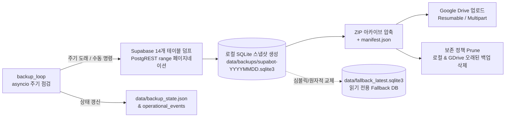

# Supabase 정기 백업 및 로컬 SQLite 폴백 개발 계획서

## 1. 개요
현재 `supabot`은 Supabase REST API를 주 데이터 저장소로 사용하며, 장애 시 쓰기 지연 큐(`data/db_sync_queue.json`)만 존재하고 **정기 백업(로컬 SQLite 스냅샷 / Google Drive 원격 백업)** 및 **읽기 폴백(Fallback)** 기능이 없다.
본 문서는 `deboox` 프로젝트의 관리자 백업/스케줄러 아키텍처를 참고하여, `supabot`의 단일 프로세스 `asyncio` 환경에 맞춘 정기 백업 및 단계적 로컬 폴백 구현 계획을 정의한다.

---

## 2. 참조 아키텍처 (`deboox`) 분석 및 이식 범위

| 구분 | `deboox` 구현 방식 | `supabot` 적용 방침 |
|---|---|---|
| **Google Drive 연동** | `google_drive.py`: 외부 SDK 없이 표준 `urllib`로 OAuth 토큰 갱신, 폴더 생성, Multipart/Resumable(5MB+) 업로드, 429/5xx 지수 백오프, 목록 조회/삭제 구현 | **핵심 로직 그대로 이식** (`src/core/gdrive_client.py`). Flask `current_app` 의존성(`_is_mock_token`)만 제거 |
| **스케줄러 & 워커** | 다중 워커(Gunicorn) 환경을 위해 DB 락 테이블(`backup_scheduler_state`) + 작업 큐(`backup_jobs`) + 데몬 스레드 2개 운영 | **단순화**. `supabot`은 단일 컨테이너 `asyncio` 루프이므로 `db_sync.py`와 동일한 `asyncio.create_task` 백그라운드 루프로 구현 (`asyncio.to_thread`로 I/O 블로킹 격리) |
| **보존 정책 (Prune)** | 로컬 및 Google Drive에서 `maxBackupsToKeep` 개수 초과 시 오래된 백업 파일 자동 삭제 | **동일하게 적용** (로컬 `data/backups/` 및 Google Drive 폴더 각각 최신 N개 유지) |
| **인증 관리** | 다중 사용자/관리자 웹 OAuth 연동 및 DB 토큰 테이블 관리 | 관리자 단일 시스템이므로 `.env` 환경변수(`GDRIVE_CLIENT_ID`, `GDRIVE_CLIENT_SECRET`, `GDRIVE_REFRESH_TOKEN`) 또는 Manager 웹 연동을 통해 `system_config`에 저장 |

---

## 3. 시스템 아키텍처 및 데이터 흐름



### 3.1 백업 대상 테이블 (총 14개)
`shared/schema.sql` 기준 전체 테이블을 1,000행 단위(`range(start, end)`) 페이지네이션으로 조회하여 로컬 SQLite 파일에 동일 테이블 구조(JSONB 컬럼은 TEXT 직렬화)로 적재한다.
- **핵심 설정/거래 테이블**: `users`, `orders`, `dca_schedules`, `system_config`, `strategy_templates`, `budget_ledger`
- **이력/로그 테이블**: `trade_logs`, `operational_events`, `nl_logs`, `command_logs`, `command_log_daily`, `feedbacks`
- **캐시/스냅샷 테이블**: `kr_stock_cache`, `market_top_snapshots`
  - *옵션*: 용량 최적화가 필요할 경우 캐시성 테이블(`kr_stock_cache`, `market_top_snapshots`) 또는 오래된 로그는 제외하거나 최근 N일치만 덤프하도록 설정 분리 가능.

---

## 4. 모듈별 상세 설계

### 4.1 `src/core/backup_manager.py` (신규)
1. **Supabase → SQLite 스냅샷 덤프 (`create_sqlite_snapshot`)**
   - 임시 파일(`supabot-backup-YYYYMMDD-HHMMSS.sqlite3.tmp`)에 테이블별 스키마 생성 및 배치 `INSERT` 수행.
   - `PRAGMA journal_mode=DELETE; PRAGMA synchronous=FULL; VACUUM;` 실행 후 원자적으로 `.sqlite3` 파일로 이름 변경 및 권한 `0o600` 설정.
   - 최신 스냅샷을 `data/fallback_latest.sqlite3`로 복사하여 향후 폴백 조회 시 즉시 사용할 수 있게 유지.
2. **ZIP 패키징 (`package_backup_zip`)**
   - 생성된 `.sqlite3` 파일과 메타데이터(`manifest.json`: 생성 시각, 테이블별 row count, 봇 버전, 스키마 버전)를 묶어 `.zip` 생성.
   - 로컬 `data/` 내 보조 파일(`users.json`, `db_sync_queue.json`)도 함께 아카이브에 포함.
3. **보존 정책 실행 (`prune_backups`)**
   - 로컬 `data/backups/` 및 Google Drive 폴더 내 파일 목록을 생성일 역순 정렬 후 `BACKUP_MAX_KEEP`(기본값: 로컬 7개, GDrive 14개) 초과분 삭제.
4. **스케줄러 루프 (`backup_loop` / `start_backup_loop`)**
   - `main.py` 기동 시 `start_sync_loop()`와 나란히 백그라운드 태스크로 시작.
   - 1시간 주기로 깨어나 `data/backup_state.json`의 `last_success_at`을 확인하고, 설정된 주기(`BACKUP_INTERVAL_HOURS`, 기본 24시간)가 경과했으면 백업 수행.
   - 실패 시 `operational_events`에 에러를 기록하고 다음 점검 주기에 재시도.

### 4.2 `src/core/gdrive_client.py` (신규 — `deboox` 이식)
- `refresh_access_token(client_id, client_secret, refresh_token)`: OAuth2 Refresh Token으로 Access Token 발급.
- `ensure_backup_folder_exists(access_token, folder_name="supabot-backups")`: 백업 전용 폴더 ID 조회/생성.
- `upload_file_to_gdrive(...)`: 5MB 이상 Resumable Upload, 미만 Multipart Upload, 지수 백오프(1s, 2s, 4s) 재시도.
- `list_gdrive_backups(...)` / `delete_file_from_gdrive(...)`: 원격 백업 목록 조회 및 보존 개수 초과분 삭제.

### 4.3 환경변수 및 설정 (`config/.env.template` & `system_config`)
```env
# 백업 기본 설정
BACKUP_ENABLED=true
BACKUP_INTERVAL_HOURS=24
BACKUP_LOCAL_MAX_KEEP=7
BACKUP_GDRIVE_MAX_KEEP=14
BACKUP_GDRIVE_FOLDER=supabot-backups

# Google Drive OAuth2 인증 정보 (선택: 미설정 시 로컬 SQLite 백업만 수행)
GDRIVE_CLIENT_ID=
GDRIVE_CLIENT_SECRET=
GDRIVE_REFRESH_TOKEN=
```

### 4.4 인터페이스 연동 (텔레그램 & Manager UI)
1. **텔레그램 관리자 명령어 (`src/handlers/system_handlers.py`)**
   - `/backup status`: 마지막 백업 성공 시각, 로컬/GDrive 백업 파일 수, 용량, 스케줄러 상태 조회.
   - `/backup now`: 즉시 백업 실행 트리거 및 완료 알림 수신.
2. **Manager 백엔드/프론트엔드 (`manager/backend/routers/`, `manager/frontend/`)**
   - 백업 상태 및 이력 조회 API, 수동 백업 실행 버튼, Google Drive OAuth 연동/토큰 갱신 UI (`deboox`의 `AdminSystemBackupSection.tsx` 참고).

### 4.5 로컬 SQLite Fallback 설계 (실거래 안전성 준수)
> [!WARNING]
> `docs/100_project_standards.md`에 따라 실거래 주문/잔고 상태의 정합성이 최우선이다. 무분별한 양방향 DB 폴백은 Split-Brain(중복 주문, 취소 누락)을 유발할 수 있으므로 **읽기 전용 폴백 + 기존 쓰기 큐(`db_sync.py`) 결합** 방식으로 설계한다.

- **쓰기(Write) 장애 시**: 기존 `db_sync.py`(`data/db_sync_queue.json`)가 `users`, `orders` 변경사항을 로컬 큐에 적재하고 복구 시 반영.
- **읽기(Read) 장애 시**: Supabase REST 호출이 연속 실패(타임아웃/5xx)할 경우, `data/fallback_latest.sqlite3` 스냅샷에서 `system_config`, `strategy_templates`, `dca_schedules` 등 조회성 데이터를 읽어 봇 루프 중단을 방지.

---

## 5. 단계별 구현 로드맵 (Phases)

### Phase 1: 로컬 SQLite 정기 스냅샷 및 스케줄러 코어
- [x] `src/core/backup_manager.py` 작성 (14개 테이블 페이지네이션 덤프, SQLite 파일 생성, ZIP 압축, 로컬 Prune).
- [x] `data/backup_state.json` 상태 영속화 및 `start_backup_loop()`를 `src/main.py`에 연결.
- [x] 단위 테스트 작성 (`tests/test_backup_manager.py`: Mock Supabase 응답 기반 SQLite 생성 및 Prune 검증).

### Phase 2: Google Drive 원격 백업 연동
- [x] `deboox`의 `google_drive.py`를 `src/core/gdrive_client.py`로 이식.
- [x] `backup_manager.py`에 Google Drive 업로드 및 원격 Prune 단계 연결.
- [x] 단위 테스트 작성 (`tests/test_gdrive_client.py`: 업로드/리프레시/백오프 재시도 검증).

### Phase 3: 운영 제어 (텔레그램 명령어 & Manager 관리자 화면)
- [x] 텔레그램 관리자 전용 `/backup status`, `/backup now` 핸들러 추가.
- [x] Manager 웹 대시보드 내 백업 상태 카드, 수동 백업 트리거, 백업 파일 목록/다운로드 API 및 프론트엔드 UI(`AdminBackupTab.tsx`) 추가.

### Phase 4: 읽기 전용 Local SQLite Fallback 연동 (선택/심화)
- [x] `src/core/db.py`에 `data/fallback_latest.sqlite3` 읽기 폴백 어댑터(`query_fallback`, `is_fallback_available`) 추가.

---

## 6. 수용 기준 (Acceptance Criteria)
1. 봇 기동 후 설정된 주기(`BACKUP_INTERVAL_HOURS`)마다 Supabase 전체 테이블이 누락 없이(1,000건 초과 테이블 포함) 로컬 `.sqlite3` 및 `.zip`으로 백업된다.
2. Google Drive 인증 정보가 설정된 경우, 백업 ZIP 파일이 지정된 Drive 폴더에 자동 업로드되고 보존 개수(`BACKUP_GDRIVE_MAX_KEEP`)를 초과한 구버전 파일은 자동 삭제된다.
3. 백업 도중 네트워크 오류가 발생하더라도 메인 트레이딩/시그널 루프가 블로킹되거나 중단되지 않는다.
4. 모든 신규 모듈은 `pytest` 단위 테스트를 통과하며 실거래 API나 운영 DB 데이터를 오염시키지 않는다.
