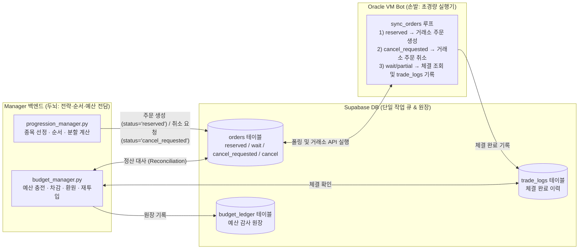

# 초경량 Bot(Thin Executor) 및 Manager 백엔드 중앙집중화 개발 계획서

> **대상 에이전트**: Gemini 3.8 Flash (코딩 실행 에이전트)
> **작성 목적**: Oracle VM의 `bot`(`src/`)은 거래소 API 호출·상태 동기화만 수행하는 초경량 워커로 단순화하고, 어떤 종목을 언제 살지·사이클 순서·예산 충전/소진/환원/재투입 등 모든 전략 판단은 `manager`(`manager/backend/`)에서 전담하도록 아키텍처와 데이터 정합성을 완성한다.

---

## 0. 에이전트 작업 준수 사항 (필독)

1. **실거래 안전 규칙 준수 (`docs/100_project_standards.md`)**
   - 모든 테스트에서 실제 거래소 네트워크 호출(`create_order`, `cancel_order`, `get_ticker`, `get_balances`)은 반드시 `unittest.mock.patch` 또는 `AsyncMock`으로 모킹(Mock)한다.
   - 기존 테스트(`pytest tests/`)가 단 하나도 깨지지 않도록 하위 호환성을 유지하며 단계별(Phase 1 → Phase 2 → Phase 3)로 구현한다.
2. **작업 검증 명령어**
   - 문법 검사: `python -m py_compile src/main.py src/core/order_manager.py manager/backend/services/progression_manager.py manager/backend/services/budget_manager.py`
   - 단위 테스트 실행: `pytest tests/test_kospi_top_strategy.py tests/test_sync_orders.py`
   - 전체 회귀 테스트: `pytest tests/`

---

## 1. 아키텍처 목표 및 현재 문제점 진단

### 1.1. 목표 아키텍처 (Target Architecture)



### 1.2. 현재 코드베이스의 4가지 핵심 결함

1. **[결함 1] 미체결 취소/실패 주문의 DB 삭제로 인한 예산 환원 누락 (`src/main.py`, `progression_manager.py`)**
   - `src/main.py`의 `_process_order_fill`(921줄) 및 `_submit_reserved_or_reorder`(745줄)는 주문이 취소(`state == "cancel"`)되거나 재시도 한도를 초과하면 `order_manager.remove_order(uuid)`를 호출해 Supabase `orders` 테이블에서 행을 **영구 삭제(`DELETE`)**한다.
   - 반면 `manager/backend/services/progression_manager.py`의 `run_strategy_progression`(370~415줄)은 다음 날 `orders` 테이블을 조회하여 `status in ("cancel", "failed", "rejected", "market_closed")`인 주문을 찾아 예산을 환원(`refund_cancelled_orders`)하고 `current_cycle_bought`에서 롤백하도록 작성되어 있다.
   - 이미 `orders` 테이블에서 삭제된 주문은 조회 결과(`status_map`)에 없으므로, **미체결 취소 주문인데도 정상 체결된 것처럼 취급되어 예산이 환원되지 않고 사이클 매수 순서에서도 누락**된다.
2. **[결함 2] 실전 매도 체결 대금의 예산 재투입(`recycle_sell_proceeds`) 미연결 (`progression_manager.py`)**
   - `budget_manager.recycle_sell_proceeds` 함수가 구현되어 있으나, `run_strategy_progression`에서 직전 배치의 `pending_sell_orders` 체결 여부를 `trade_logs`와 대조해 가용 예산(`carryover_budget`)으로 재투입하는 호출 로직이 누락되어 있다.
3. **[결함 3] Supabase 기반 취소 작업 큐(`cancel_requested`) 부재 (`src/main.py`, `budget_manager.py`)**
   - `budget_manager.reset_budget_plan`(503~509줄)은 `orders` 테이블의 `status`만 `"cancel"`로 업데이트하지만, Bot의 `sync_orders`는 이를 감지해 거래소에 취소 요청을 보내는 로직이 없다.
   - Bot이 DB의 `status == "cancel_requested"`를 읽어 거래소 취소를 실행하도록 만들면, Manager는 웹훅에 의존하지 않고도 DB 상태 변경만으로 안전하게 주문을 취소할 수 있다.
4. **[결함 4] 단일 종목 전략(`grid`, `sgrid`, `rsitrade`, `dca`)의 Bot 실행 의존성 (`templates.py`, `internal_api.py`)**
   - `kospi_top_dca`와 달리 단일 종목 전략들은 아직 Manager에서 계산하지 않고 Bot의 `/internal/execute_*` 웹훅을 호출해 Bot 내부에서 가격 계산 및 주문을 생성하고 있다.

---

## 2. 단계별 상세 구현 명세 (Implementation Steps)

---

### Phase 1: `kospi_top_dca` 정산(Reconciliation) 무결성 확보 (최우선)

#### Task 1.1: `progression_manager.py` — 미체결 매수 주문 정산 로직 보강 (`orders` 삭제 및 `trade_logs` 대조 지원)
- **대상 파일**: `manager/backend/services/progression_manager.py`
- **위치**: `run_strategy_progression` 내 `4. 직전 배치 미체결 취소 주문 정산 (Reconciliation)` 블록 (약 369~415줄)
- **수정 원리**:
  - Bot이 취소된 주문을 `orders` 테이블에서 `DELETE`했더라도, 체결된 주문은 반드시 `trade_logs` 테이블에 기록된다(`uuid` 또는 교체된 신규 `uuid` 기준).
  - 따라서 `pending_buy_orders`의 각 주문(`pb`)에 대해:
    1. `orders` 테이블에 아직 남아 있으면서 `status in ("cancel", "failed", "rejected", "market_closed", "cancel_requested")`인 경우 → 미체결 취소로 판정.
    2. `orders` 테이블에서 이미 사라진(`s_info is None`) 경우 → `trade_logs` 테이블에서 해당 주문(`uuid` 또는 `template_id` + `group_no` + `ticker` + `side='bid'`)의 실제 체결 수량(`executed_vol`)을 조회한다.
       - 만약 `executed_vol < float(pb.get("volume", 0.0))`이면, 미체결 잔량(`volume - executed_vol`)만큼 거래소에서 취소/실패 후 삭제된 것이므로 `pb["filled_volume"] = executed_vol`로 설정하여 `cancelled` 리스트에 추가한다.
- **구체적 코드 변경 예시**:
```python
        # 4. 직전 배치 미체결 취소 주문 정산 (Reconciliation)
        pending_buys = params.get("pending_buy_orders", [])
        if pending_buys:
            order_uuids = [o["uuid"] for o in pending_buys if "uuid" in o]
            if order_uuids:
                status_map = {}
                try:
                    ord_res = await db.table("orders").select("uuid,status,filled_volume,price,volume,reorder_of").in_("uuid", order_uuids).execute()
                    for o in (ord_res.data or []):
                        status_map[o["uuid"]] = o
                except Exception as e:
                    logger.warning(f"Failed to query orders by uuid: {e}")

                try:
                    reorder_res = await db.table("orders").select("uuid,status,filled_volume,price,volume,reorder_of").in_("reorder_of", order_uuids).execute()
                    for o in (reorder_res.data or []):
                        if o.get("reorder_of"):
                            status_map[o["reorder_of"]] = o
                except Exception as e:
                    logger.debug(f"reorder_of lookup fallback: {e}")

                # orders 테이블에서 삭제된 주문의 체결 여부를 확인하기 위해 trade_logs 조회
                trade_vol_by_group_ticker: dict[tuple, float] = {}
                try:
                    t_res = (
                        await db.table("trade_logs")
                        .select("uuid,ticker,side,volume,group_no")
                        .eq("template_id", template_id)
                        .eq("side", "bid")
                        .execute()
                    )
                    for tr in (t_res.data or []):
                        key = (tr.get("group_no"), tr.get("ticker"))
                        trade_vol_by_group_ticker[key] = trade_vol_by_group_ticker.get(key, 0.0) + float(tr.get("volume") or 0.0)
                except Exception as e:
                    logger.warning(f"Failed to query trade_logs for reconciliation: {e}")

                cancelled = []
                for pb in pending_buys:
                    s_info = status_map.get(pb["uuid"])
                    c_code = pb.get("code") or pb.get("ticker")
                    pb_vol = float(pb.get("volume", 0.0))
                    if s_info:
                        st = s_info.get("status")
                        if st in ("cancel", "failed", "rejected", "market_closed", "cancel_requested"):
                            pb["filled_volume"] = float(s_info.get("filled_volume", 0.0))
                            cancelled.append(pb)
                            if st == "market_closed":
                                try:
                                    await db.table("orders").update({"status": "cancel"}).eq("uuid", s_info["uuid"]).execute()
                                except Exception as e:
                                    logger.warning(f"Failed to mark market_closed order as cancel: {e}")
                    else:
                        # orders 테이블에 행이 없는 경우: trade_logs에 체결 내역이 있는지 대조
                        # (단, trade_logs 조회 자체가 비어 있고 테스트/모킹 환경에서 orders만 모킹한 경우를 구분하기 위해
                        #  trade_logs에 다른 체결이 있거나 명시적으로 미체결 확인이 가능한 경우 처리)
                        key = (pb.get("group_no"), c_code)
                        exec_vol = trade_vol_by_group_ticker.get(key, 0.0)
                        if exec_vol < pb_vol:
                            pb["filled_volume"] = exec_vol
                            cancelled.append(pb)
```
> **주의**: 기존 단위 테스트(`tests/test_kospi_top_strategy.py`)에서 `trade_logs`를 모킹하지 않은 케이스와 충돌하지 않도록, `src/main.py`에서도 `kospi_top_dca` 주문 취소 시 `status="cancel"`을 먼저 업데이트하거나 위 조건을 안전하게 처리해야 한다(Task 1.3 참조).

---

#### Task 1.2: `progression_manager.py` — 직전 배치 매도 체결 대금 재투입(`recycle_sell_proceeds`) 연결
- **대상 파일**: `manager/backend/services/progression_manager.py`
- **위치**: `run_strategy_progression` 내 `4. 직전 배치 미체결 취소 주문 정산` 직후, `5. 일일 예산 충전` 직전 (약 415줄 부근)
- **수정 내용**:
  - `params.get("sell_proceeds_mode") == "recycle_to_budget"`이고 `params.get("pending_sell_orders")`가 존재할 때:
  - `trade_logs` 테이블에서 해당 `template_id`, `side="ask"`, `group_no`에 해당하는 실제 매도 체결 내역을 조회(또는 `orders` 테이블에서 완료 여부 확인)하여, 체결된 매도 대금(`price * volume - fee_amount`)에 대해 `await budget_manager.recycle_sell_proceeds(...)`를 호출한다.
  - 정산이 끝난 `pending_sell_orders`는 중복 재투입 방지를 위해 비워준다(`params["pending_sell_orders"] = []`).
- **구체적 코드 추가 예시**:
```python
        # 4-2. 직전 배치 매도 체결 대금 예산 재투입 (recycle_to_budget 모드)
        pending_sells = params.get("pending_sell_orders", [])
        if pending_sells and params.get("sell_proceeds_mode") == "recycle_to_budget":
            try:
                sell_groups = list({ int(s["group_no"]) for s in pending_sells if s.get("group_no") is not None })
                if sell_groups:
                    s_tr_res = (
                        await db.table("trade_logs")
                        .select("uuid,ticker,side,price,volume,fee_amount,group_no")
                        .eq("template_id", template_id)
                        .eq("side", "ask")
                        .in_("group_no", sell_groups)
                        .execute()
                    )
                    recycled_uuids = set(params.get("recycled_sell_uuids", []))
                    for tr in (s_tr_res.data or []):
                        tr_uuid = tr.get("uuid") or f"{tr.get('group_no')}:{tr.get('ticker')}"
                        if tr_uuid in recycled_uuids:
                            continue
                        proceeds = float(tr.get("price") or 0.0) * float(tr.get("volume") or 0.0) - float(tr.get("fee_amount") or 0.0)
                        if proceeds > 0:
                            params = await budget_manager.recycle_sell_proceeds(
                                template=template,
                                proceeds_krw=proceeds,
                                ticker=tr.get("ticker", ""),
                                order_uuid=tr.get("uuid"),
                                group_no=tr.get("group_no"),
                            )
                            recycled_uuids.add(tr_uuid)
                    params["recycled_sell_uuids"] = list(recycled_uuids)[-200:]
            except Exception as e:
                logger.warning(f"Failed to recycle sell proceeds: {e}")
            params["pending_sell_orders"] = []
```
- 또한 `RUNTIME_STATE_KEYS` 집합(35줄)에 `"recycled_sell_uuids"`를 추가한다.

---

### Phase 2: Supabase 기반 취소 작업 큐(`cancel_requested`) 및 취소 상태 보존 구현

#### Task 2.1: `src/main.py` — `sync_orders`에서 `status == "cancel_requested"` 처리 추가
- **대상 파일**: `src/main.py`
- **위치**: `sync_orders` 함수 내부 1차 필터링 루프 (약 940~960줄)
- **수정 내용**:
  - Manager 백엔드가 주문을 취소하고자 할 때 Supabase `orders` 테이블의 `status`를 `"cancel_requested"`로 변경하면, Bot의 `sync_orders`가 이를 감지하여 즉시 거래소 취소를 수행한다.
  - 만약 주문의 `uuid`가 `"reserved:"`로 시작하거나 아직 거래소에 제출되지 않은 주문이면 거래소 API 호출 없이 바로 취소 처리하고, 거래소에 제출된 주문이면 `cancel_and_remove_order(user_id, ord)`를 호출한다.
- **구체적 코드 추가 예시 (`src/main.py` `sync_orders` 내)**:
```python
        # 0. 백엔드(Manager)로부터 취소 요청(cancel_requested)된 주문 처리
        if ord.get("status") == "cancel_requested":
            if str(ord["uuid"]).startswith("reserved:"):
                order_manager.remove_order(ord["uuid"])
            else:
                await cancel_and_remove_order(user_id, ord)
            continue
```

#### Task 2.2: `manager/backend/services/budget_manager.py` — `reset_budget_plan`에서 안전한 주문 취소 적용
- **대상 파일**: `manager/backend/services/budget_manager.py`
- **위치**: `reset_budget_plan` 함수 내 `if cancel_pending:` 블록 (499~513줄)
- **문제점**: 현재 `.update({"status": "cancel"})`로만 되어 있어 거래소에 나가 있는 `wait` 주문이 실제로 취소되지 않는다.
- **수정 내용**:
  - `reserved` 상태 주문은 `"cancel"`(또는 삭제) 처리하고, `wait` / `partial` 상태 주문은 `"cancel_requested"`로 업데이트함과 동시에 `bot_client.cancel_order`를 시도(실패해도 Bot의 `sync_orders`가 `cancel_requested`를 보고 재시도)하도록 변경한다.
```python
    # 기존 미체결 매수 주문 취소 요청
    if cancel_pending:
        db = get_db()
        try:
            await (
                db.table("orders")
                .update({"status": "cancel_requested"})
                .eq("template_id", template["id"])
                .eq("side", "bid")
                .in_("status", ["wait", "reserved", "partial", "pending_reorder"])
                .execute()
            )
        except Exception as e:
            logger.warning(f"Failed to request cancel for pending orders on budget reset: {e}")
```

---

### Phase 3: 단일 종목 전략(`grid`, `sgrid`, `rsitrade`)의 Manager 백엔드 계산 이관 (선택적 확장)

> **목표**: `kospi_top_dca`처럼 `grid`, `sgrid`, `rsitrade`도 Manager 백엔드가 직접 분할 가격·수량을 계산해 Supabase `orders` 테이블에 `status="reserved"`로 적재하고, Bot은 `sync_orders`를 통해 실행만 하도록 일원화한다.

#### Task 3.1: `manager/backend/services/order_planner.py` 신설
- **역할**:
  1. `plan_grid_orders(user_id, exchange, ticker, start_price, end_price, count, budget_or_volume, is_sell, group_no, template_id)`:
     - 등간격 가격 계산 + 호가 단위(Tick Size) 보정 + 수수료 버퍼(`0.999`) 반영 수량 계산 후 `orders` 테이블에 넣을 `status="reserved"` 주문 dict 리스트 반환.
  2. `plan_rsitrade_orders(...)`:
     - 목표 RSI 구간 등간격 분할 + 가격 역산 후 `orders` 테이블에 넣을 `status="reserved"` 주문 dict 리스트 반환.
- **효과**:
  - Manager의 `api_execute_template`(`manager/backend/routers/templates.py`)이 Bot의 `/internal/execute_grid`, `/internal/execute_sgrid` 웹훅을 호출할 필요 없이, 직접 `orders` 테이블에 `status="reserved"` 배치를 `insert`하고 Bot은 다음 폴링 주기에 거래소에 주문을 제출하게 된다.
  - Bot 장애나 네트워크 순단 시에도 주문 의도가 Supabase `orders` 테이블에 100% 보존된다.

---

## 3. 테스트 작성 및 검증 계획 (Verification Plan)

코딩 완료 후 `tests/test_kospi_top_strategy.py`에 아래 3개의 단위 테스트를 추가하고 통과 여부를 확인한다.

1. **`test_reconciliation_handles_deleted_unfilled_orders_via_trade_logs`**
   - **시나리오**: 전일 `pending_buy_orders`에 있던 주문(`ord-del-1`)이 장 마감 취소되어 Bot이 `orders` 테이블에서 삭제했고 `trade_logs`에도 체결 내역이 없는 상태.
   - **기대 결과**: `run_strategy_progression` 실행 시 해당 주문이 미체결 취소로 감지되어 `refund_cancelled_orders`를 통해 예산이 전액 환원되고, `current_cycle_bought`에서 해당 종목이 제거되어야 한다.
2. **`test_run_strategy_progression_recycles_sell_proceeds`**
   - **시나리오**: `sell_proceeds_mode="recycle_to_budget"`인 템플릿에서 전일 `pending_sell_orders`로 나간 매도 주문이 `trade_logs`에 체결(예: 100,000원)로 기록된 상태.
   - **기대 결과**: 다음 날 `run_strategy_progression` 실행 시 `SELL_PROCEEDS_RECYCLE` 원장이 기록되고 `carryover_budget`에 매도 체결 대금이 합산되어야 한다.
3. **`test_sync_orders_executes_cancel_requested`** (`tests/test_sync_orders.py`)
   - **시나리오**: `orders` 테이블에 `status="cancel_requested"`인 주문이 존재할 때 `sync_orders` 실행.
   - **기대 결과**: `exchange_adapter.cancel_order`가 호출되고 `order_manager`에서 해당 주문이 정리되어야 한다.
