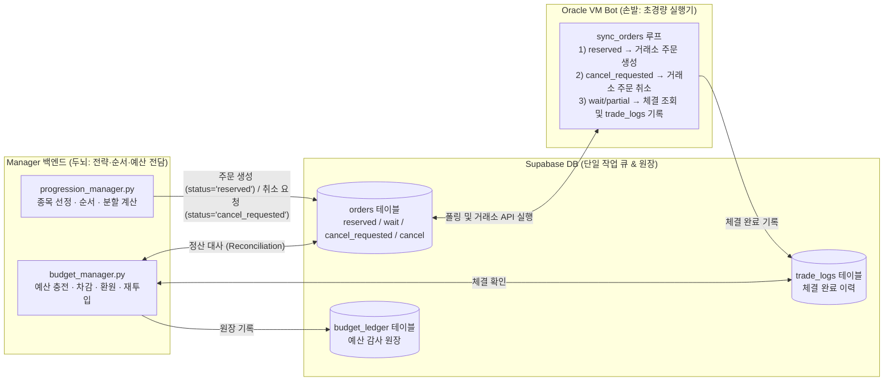

# 초경량 Bot(Thin Executor) 및 Manager 백엔드 중앙집중화 개발 계획서

> **대상 에이전트**: Gemini 3.8 Flash (코딩 실행 에이전트)
> **작성 목적**: Oracle VM의 `bot`(`src/`)은 거래소 API 호출·상태 동기화만 수행하는 초경량 워커로 단순화하고, 어떤 종목을 언제 살지·사이클 순서·예산 충전/소진/환원/재투입 등 모든 전략 판단은 `manager`(`manager/backend/`)에서 전담하도록 아키텍처와 데이터 정합성을 완성한다.

---

## 0. 에이전트 작업 준수 사항 (필독)

1. **실거래 안전 규칙 준수 (`docs/100_project_standards.md`)**
   - 모든 테스트에서 실제 거래소 네트워크 호출(`create_order`, `cancel_order`, `get_ticker`, `get_balances`)은 반드시 `unittest.mock.patch` 또는 `AsyncMock`으로 모킹(Mock)한다.
   - 기존 테스트(`pytest tests/`)가 단 하나도 깨지지 않도록 하위 호환성을 유지하며 단계별(Phase 1 → Phase 2 → Phase 3)로 구현한다.
2. **작업 검증 명령어**
   - 문법 검사: `python -m py_compile src/main.py src/core/order_manager.py manager/backend/services/progression_manager.py manager/backend/services/budget_manager.py`
   - 단위 테스트 실행: `pytest tests/test_kospi_top_strategy.py tests/test_sync_orders.py`
   - 전체 회귀 테스트: `pytest tests/`

---

## 1. 아키텍처 목표 및 현재 문제점 진단

### 1.1. 목표 아키텍처 (Target Architecture)

### 1.2. 핵심 결함 및 해결 방안

1. **[결함 1] 미체결 취소/실패 주문의 DB 삭제로 인한 예산 환원 누락 (`src/main.py`, `progression_manager.py`)**
   - 취소 주문이 `orders` 테이블에서 삭제되더라도 `trade_logs`를 대조하여 실제 체결 수량을 파악, 미체결 잔량만큼 예산 환원(`refund_cancelled_orders`) 및 사이클 롤백 처리.
2. **[결함 2] 실전 매도 체결 대금의 예산 재투입(`recycle_sell_proceeds`) 미연결 (`progression_manager.py`)**
   - `sell_proceeds_mode="recycle_to_budget"` 시 직전 배치 매도 체결 대금을 조회하여 `carryover_budget`으로 재투입.
3. **[결함 3] Supabase 기반 비동기 취소 작업 큐(`cancel_requested`) 부재 및 정산 정합성 문제**
   - Manager는 주문의 `status`를 `"cancel_requested"`로 변경하여 안전하게 취소를 위임.
   - Bot은 취소 전 실거래소 체결 여부를 선조회하여 전량 체결(`done`) 시 즉시 체결 처리하고, 부분 체결 시 취소 완료 후 `trade_logs`에 기록.
   - 취소 확정 전(`cancel_requested`) 주문은 정산 시 즉시 환불하지 않고 다음 배치로 이월(`deferred_pending_buys`)하여 취소 확정 후 정산.
4. **[결함 4] 단일 종목 전략(`grid`, `sgrid`, `rsitrade`, `dca`)의 Bot 실행 의존성**
   - Manager에서 직접 분할 주문(`status="reserved"`)을 생성하도록 이관 추진.

---

## 2. 단계별 상세 구현 명세 (Implementation Steps)

---

### Phase 1: `kospi_top_dca` 정산(Reconciliation) 무결성 확보 (완료)

#### Task 1.1: `progression_manager.py` — 미체결 매수 주문 정산 로직 보강 (`orders` 삭제 및 `trade_logs` 대조 지원)
- **대상 파일**: `manager/backend/services/progression_manager.py`
- **위치**: `run_strategy_progression` 내 `4. 직전 배치 미체결 취소 주문 정산 (Reconciliation)` 블록
- **수정 내용**:
  1. `orders` 테이블에 남아 있으면서 `status == "cancel_requested"`인 주문:
     - 봇의 거래소 취소 확정 전에는 체결 가능성이 있으므로 환불하지 않고 `deferred_pending_buys`에 보관 후 다음 배치의 `pending_buy_orders`로 이월.
  2. `orders` 테이블에 남아 있으면서 `status in ("cancel", "failed", "rejected", "market_closed")`인 경우:
     - 확정된 미체결 취소로 판정하여 `cancelled`에 추가하고 `refund_cancelled_orders` 수행.
  3. `orders` 테이블에서 이미 삭제된 경우:
     - `trade_logs`에서 실제 체결 수량(`executed_vol`)을 조회하여 미체결 잔량(`volume - executed_vol`)을 환불 처리.

#### Task 1.2: `progression_manager.py` — 매도 대금 예산 재투입 연동 (완료)
- `sell_proceeds_mode == "recycle_to_budget"`일 때 직전 매도 주문의 체결 대금을 `trade_logs`에서 조회하여 `budget_manager.recycle_sell_proceeds` 호출.

---

### Phase 2: Supabase 기반 취소 작업 큐(`cancel_requested`) 및 웹 UI 연동 (완료)

#### Task 2.1: `src/main.py` — `sync_orders`의 `_handle_cancel_requested` 구현 (완료)
- **대상 파일**: `src/main.py`
- **수정 내용**:
  - `reserved:` 가상 UUID는 거래소 미제출 상태이므로 `order_manager.remove_order(uuid)`로 즉시 제거.
  - 거래소 제출 주문은 실거래소 취소 호출 전 `get_order_status` 선조회:
    - 전량 체결(`state == "done"`): `_process_order_fill`로 즉시 체결 처리.
    - 부분 체결(`executed_volume > 0`): 취소 완료 후 `append_trade`로 부분 체결분을 `trade_logs`에 기록 (수수료, `group_no`, `template_id` 유지).
    - 거래소 취소 실패 시: 주문을 삭제하지 않고 `cancel_requested` 상태를 유지하여 다음 sync 주기에서 재시도.

#### Task 2.2: `manager/backend/services/budget_manager.py` — `reset_budget_plan` 안전 취소 (완료)
- 기존 미체결 매수 주문 취소 시 `orders` 테이블의 상태를 `"cancel_requested"`로 업데이트하여 봇이 거래소 취소를 실행하도록 위임.

#### Task 2.3: 웹 매니저 UI 및 대시보드 표시 지원 (완료)
- `manager/backend/routers/orders.py`:
  - `_STATUS_LABELS`에 `"cancel_requested": "취소중"` 추가.
  - `_LISTED_OPEN_STATUSES = _OPEN_STATUSES + ("cancel_requested",)`로 열린 주문 목록 조회에 포함 (취소 API는 기존 `_OPEN_STATUSES` 유지하여 중복 취소 방지).
- `manager/backend/routers/dashboard.py`:
  - 대시보드 `orders_open` 집계에 `cancel_requested` 포함.
- `manager/frontend/src/components/ui/Badge.tsx`:
  - `cancel_requested: '취소중'` 배지(로즈 계열) 및 컬러 매핑 추가.

---

### Phase 3: 단일 종목 전략(`grid`, `sgrid`, `rsitrade`)의 Manager 백엔드 계산 이관 (선택적 확장)

> **목표**: `kospi_top_dca`처럼 `grid`, `sgrid`, `rsitrade`도 Manager 백엔드가 직접 분할 가격·수량을 계산해 Supabase `orders` 테이블에 `status="reserved"`로 적재하고, Bot은 `sync_orders`를 통해 실행만 하도록 일원화한다.

---

## 3. 테스트 작성 및 검증 (Verification)

코딩 완료 후 아래 테스트들이 통과함을 검증한다.

1. **`test_reconciliation_handles_deleted_unfilled_orders_via_trade_logs`**
   - 전일 주문이 거래소 취소 후 삭제되고 `trade_logs`에 없는 경우 환불 및 사이클 롤백 검증.
2. **`test_run_strategy_progression_recycles_sell_proceeds`**
   - 매도 체결 대금이 `carryover_budget`으로 재투입되는지 검증.
3. **`test_reconciliation_defers_refund_for_cancel_requested_orders`**
   - 봇이 거래소 취소를 확정하기 전(`cancel_requested`)에는 환불을 보류하고 다음 배치로 이월하는지 검증.
4. **`test_sync_orders_executes_cancel_requested`**
   - `cancel_requested` 주문 감지 시 `exchange_adapter.cancel_order` 호출 검증.
5. **`test_sync_orders_cancel_requested_records_partial_fill`**
   - `cancel_requested` 처리 시 부분 체결분이 있을 경우 취소 후 `trade_logs`에 기록되는지 검증.
6. **`test_sync_orders_cancel_requested_retains_when_cancel_fails`**
   - 거래소 취소 실패 시 주문 삭제 없이 `cancel_requested` 상태를 유지하여 재시도하는지 검증.
